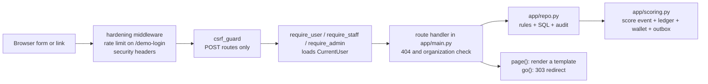

# 01 — Start

Goal: in ten minutes you have a running app, green checks and a correct mental model.

- Mode: P (Prototype) · Last reviewed: 2026-11-11
- Next: [02-continue.md](02-continue.md) · Index: [README.md](README.md)

## 1. Read in this order

`AGENTS.md` §4 requires the first three. The rest of this guide exists so you do not have to
read all the code before you start.

| # | File | Why | Time |
|---|---|---|---|
| 1 | [`AGENTS.md`](../../AGENTS.md) | The binding rules: modes, the 7-step loop, hard engineering rules, Definition of Done, handoff block | 8 min |
| 2 | [`docs/handoffs/current-state.md`](../handoffs/current-state.md) | What works, what is mocked, what is broken, what was verified and when | 4 min |
| 3 | The row you will work on in [`docs/delivery/backlog.md`](../delivery/backlog.md) | Evidence, cause in code, proposed fix, size | 2 min |
| 4 | This file | Setup, layout, request flow, invariants | 5 min |
| 5 | The matching rows in [traceability.md](traceability.md) and [code-map.md](code-map.md) | The exact functions, tables and tests you will touch | 2 min |

Read [`.agent/CONTEXT.md`](../../.agent/CONTEXT.md) in full the first time you work on product
behaviour; after that, look ids up in [traceability.md](traceability.md).
The Persian [handover](../handoffs/handover.md) tells the whole story in one read.

**Path convention of the agent kit.** `AGENTS.md`, `.agent/CONTEXT.md`, the role files, the
playbooks and the master prompt were written for a standalone kit folder and name paths relative
to it. In this repository the kit root is `.agent/`:

| Written in the kit files | Real path here |
|---|---|
| `CONTEXT.md` | `.agent/CONTEXT.md` |
| `roles/…`, `playbooks/…`, `templates/…`, `context/…`, `tools/…` | `.agent/roles/…`, `.agent/playbooks/…`, `.agent/templates/…`, `.agent/context/…`, `.agent/tools/…` |
| `backend/**`, `admin/**`, `design/**`, `infra/**` (`AGENTS.md` §5) | Do not exist in the prototype; the whole application is `app/**` |
| `docs/engineering/qa-*` (`AGENTS.md` §5) | `docs/quality/qa-test-strategy.md` |
| `CONTEXT.md` §11 for dates (`AGENTS.md` §0) | `.agent/CONTEXT.md` §۱۰ (milestones) |

## 2. Set up and verify

Requirements: Python 3.11 or newer, `make`. No database server, no Node, no Docker.

```bash
make setup     # creates .venv and installs the app with dev dependencies
make check     # ruff + pytest
make doctor    # repository health
```

Expected, as last recorded in `docs/handoffs/current-state.md` § Tests and verification:

- `ruff`: `All checks passed!`
- `pytest`: every test passes, one Starlette deprecation warning about `TestClient` (harmless);
- `doctor`: `0 fail`.

If any of these fail on a clean checkout, stop and record it in `current-state.md` before you
change anything. See [troubleshooting.md](troubleshooting.md).

```bash
make run       # http://0.0.0.0:8000 — first start creates var/kiloos.db and seeds demo data
curl -s localhost:8000/health
# {"status":"ok","mode":"P","env":"dev","demo_data":true,"message":"Prototype — sample data only"}
```

Open `/login` and pick a demo user. There is no password in the prototype (OD-01 is open).

| Demo user | Role | Lands on | Test constant in `tests/conftest.py` |
|---|---|---|---|
| سارا محمدی | visitor | `/home` | `VISITOR` (`09120000001`) |
| امیر رضایی | visitor | `/home` | `OTHER_VISITOR` (`09120000002`) |
| مریم کاظمی | visitor | `/home` | — (`09120000003`) |
| حسین کریمی | operator | `/admin/submissions` | `OPERATOR` (`09120000004`) |
| نگار تهرانی | admin | `/admin/submissions` | `ADMIN` (`09120000005`) |

Runtime data lives in `var/` (git-ignored). `make seed` deletes the database and seeds again.

## 3. Layout

```text
AGENTS.md                 binding contract for every agent
CHANGELOG.md              what changed, by date and pull request
.agent/
  CONTEXT.md              product facts and the id catalogue (MVP, BR, EP, OD, MS)
  playbooks/              how to do recurring work: vertical slice, scoring, sales import, review, prototype plan
  roles/                  the seven roles and what each must deliver
  templates/              slice plan, PR, ADR, open decision, handoff, current state
  context/                open-decision seed, sample scoring rule, traceability.json (curated links)
  tools/                  bootstrap.py, doctor.py, knowledge_map.py
app/
  main.py                 create_app(): every route, access dependency, CSRF guard, error page
  repo.py                 SQL and domain rules for missions, submissions, wallet, leaderboard, sales imports
  scoring.py              score events: award, sales award, reversal, rule-version lookup
  sales.py                XLSX parsing and row validation (never scores)
  security.py             signed session token, CSRF value, CurrentUser
  config.py               Settings and environment variables
  db.py                   connection, migration runner, first-boot seed
  seed.py                 deterministic demo data (all SAMPLE)
  jalali.py               Jalali date and Persian digit formatting
  maintenance.py          manual evidence purge
  sample_sales.py         builds the SAMPLE sales workbook
  templates/              16 Jinja templates (RTL, Persian)
  static/style.css        the only stylesheet; no JavaScript build
db/migrations/            NNNN_*.sql, applied once each, in filename order
tests/                    pytest; every test gets its own temporary database
docs/                     specifications; index in docs/README.md
graphify-out/             knowledge graph of code and docs (see knowledge-graph.md)
```

Exact function, table and route lists: [code-map.md](code-map.md).

## 4. How a request flows



What each step guarantees:

1. **Session.** `security.current_user` reads a signed token from the `?s=` query parameter
   first, then from the `kiloos_session` cookie. The URL form exists because the embedded
   preview blocks third-party cookies (D-002, demo-only).
2. **CSRF.** Every state-changing route declares `dependencies=[Depends(csrf_guard)]`. The
   expected value is derived from the session token, so it works without cookies.
   `/demo-login` is the only exemption.
3. **Access.** `require_user`, `require_staff` (operator or admin) or `require_admin`.
   No session → 303 to `/login`. Wrong role → 403 page in Persian.
4. **Organization scope.** Not part of the access dependency. The handler compares
   `organization_id` itself, or the query in `repo.py` filters by it.
5. **Domain call.** Writes happen in `repo.py` and `scoring.py`. A rule violation raises
   `DomainError(code, persian_message)`; the handler re-renders the page with the message,
   usually with status 409.
6. **Response.** `page(request, template, context, user=…)` adds `user`, `csrf`, `s` and
   `active` to the context. `go(path, request)` redirects with 303 and keeps `?s=`.

## 5. Invariants you must not break

These come from `AGENTS.md` §6 and are true of the code today. The check for each is in
[code-map.md](code-map.md) or in the tests named in [traceability.md](traceability.md).

| Invariant | How the code enforces it |
|---|---|
| Every point is a score event; history is never edited | No `UPDATE` or `DELETE` on `score_events`, `point_transactions`, `audit_logs` anywhere in `app/` (code-map §5). Corrections are negative events with `corrects_event_id` (D-004). |
| Scoring is idempotent | `score_events.idempotency_key` is unique. Keys: `mission.approved:<submission>`, `sales.record:<record>`, `score.reversed:<event>` (code-map §9). |
| Event, ledger, wallet and outbox move together | `scoring._persist_award` writes all four; the caller owns the transaction. |
| The wallet is a projection | `point_wallets.balance` must equal the sum of `point_transactions.amount` per user. Tests assert it after awards and corrections. |
| Rules are versioned | `scoring_rule_versions` has `version`, `effective_from`, `status`. Changing a mission's points publishes a new version and retires the old one; old events keep their points. |
| Sensitive actions are audited | `repo.audit(...)` in the same transaction as the change (actions listed in code-map §9). |
| Demo data is labelled | Persistent strip in `base.html`, «نمونه» pills, `is_sample` on rule versions, `"demo_data": true` in `/health`. |
| Nothing is approved | D-001…D-005 are `PROPOSED`, OD-01…OD-12 are `OPEN`. Every point value is `SAMPLE`. Only `docs/decisions/decision-log.md` can approve. |

Known places where the code does not yet meet its own rule are tracked, not hidden: approval
and scoring are two transactions (backlog A1), points pass through `float` in the reversal
path (C8), display time is UTC instead of Asia/Tehran (A3).

## 6. Vocabulary: product term → code

Product definitions: [`.agent/CONTEXT.md`](../../.agent/CONTEXT.md) §۱۵.

| Term (fa) | Table | Main functions | States |
|---|---|---|---|
| Mission (مأموریت) | `missions` | `repo.create_mission`, `update_mission`, `publish_mission`, `archive_mission` | `draft` → `active` → `archived` |
| Submission (ارسال) | `submissions` | `repo.create_submission`, `review_submission` | `submitted` → `approved` or `rejected` |
| Evidence (شاهد) | `submission_evidences` + file in `var/evidence` | `repo.create_submission`, route `GET /evidence/{evidence_id}` | — |
| Rule version (نسخه قانون) | `scoring_rule_versions` | `scoring.find_rule_version` | `published`, `retired` |
| Score event (رخداد امتیاز) | `score_events` | `scoring.award_mission_approval`, `award_sales_record`, `reverse_event` | append-only |
| Ledger entry | `point_transactions` | `scoring._persist_award` | append-only |
| Wallet (کیف امتیاز) | `point_wallets` | `repo.wallet_balance` | projection |
| Leaderboard (رتبه‌بندی) | computed on read from `score_events` and `competitions` | `repo.leaderboard` | — |
| Sales import (ورود فروش) | `sales_imports`, `sales_records`, `sales_user_map` | `sales.parse_workbook`, `sales.validate_rows`, `repo.process_sales_import` | import: `validated` → `completed` or `failed` (the schema also allows `uploaded`, `processing`, `rejected`; no code writes them). Row: `valid`, `invalid`, `duplicate`, then `scored` |
| Audit log | `audit_logs` | `repo.audit` | append-only |
| Outbox | `outbox_events` | `scoring._persist_award` | written, no consumer yet (C13) |

## 7. Where to go next

- You have a task → [02-continue.md](02-continue.md) for the pattern and the recipe.
- Something failed → [troubleshooting.md](troubleshooting.md).
- You need to know what a change will touch → [code-map.md](code-map.md) or
  [knowledge-graph.md](knowledge-graph.md).
