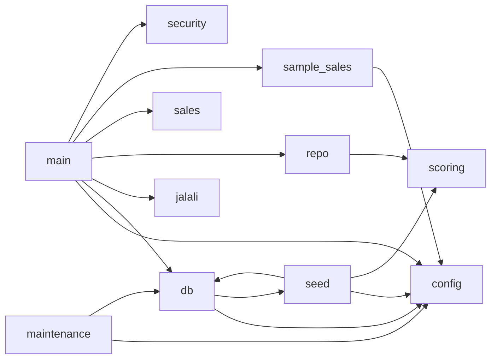

# Code Map

> **GENERATED** by `.agent/tools/knowledge_map.py` — do not edit by hand.
> Regenerate with `make docs` (or `python3 .agent/tools/knowledge_map.py`).
> `tests/test_docs.py` fails when this file no longer matches the code.

This file answers "where is it?" without searching: every route, the function that
handles it, the tables it touches, the template it renders and the tests that reach it.
It is a projection of the code. When it disagrees with the code, the code is right and
this file must be regenerated.

**Reading the notation**

- `repo.review_submission` means `app/repo.py::review_submission`; jump there with
  `grep -n "def review_submission" app/repo.py`.
- `test_flow::test_x` means `tests/test_flow.py::test_x`; run it with
  `.venv/bin/pytest tests/test_flow.py::test_x`.
- "Reads" / "Writes" are SQL tables found in string literals. For a route they are
  transitive (through every project function the handler calls).
- Access: `public` (no session), `token` (a session token is required by the CSRF
  guard, the user row is not loaded), `user` (any signed-in active user), `staff`
  (operator or admin), `admin`. Organization scope is enforced inside the handler or
  the query, not by the access level.
- "Tests" counts tests whose code requests the route by a literal path, directly or
  through a test helper. A page reached only by following a redirect is not counted.

Contents: [1 Modules](#1-modules) · [2 Routes](#2-routes) · [3 Route details](#3-route-details) · [4 Functions](#4-functions-by-module) · [5 Tables](#5-database-tables) · [6 Templates](#6-templates) · [7 Tests](#7-tests) · [8 Error codes](#8-error-codes) · [9 Constants](#9-domain-constants) · [10 Configuration](#10-configuration) · [11 Commands](#11-commands) · [12 Unresolved](#12-unresolved-references)

## 1. Modules

| Module | Symbols | Imports (project modules) |
|---|---|---|
| `app/config.py` | 2 | — |
| `app/db.py` | 4 | `config`, `seed` |
| `app/jalali.py` | 3 | — |
| `app/main.py` | 48 | `config`, `db`, `jalali`, `repo`, `sales`, `sample_sales`, `security` |
| `app/maintenance.py` | 3 | `config`, `db` |
| `app/repo.py` | 42 | `scoring` |
| `app/sales.py` | 11 | — |
| `app/sample_sales.py` | 3 | `config` |
| `app/scoring.py` | 9 | — |
| `app/security.py` | 11 | — |
| `app/seed.py` | 4 | `config`, `db`, `scoring` |

## 2. Routes

| Method | Path | Access | CSRF | Handler | Templates | Tests |
|---|---|---|---|---|---|---|
| GET | `/` | public | — | `main.root` | — | 0 |
| GET | `/admin/missions` | staff | — | `main.admin_missions` | `admin_missions.html` | 0 |
| GET | `/admin/missions/new` | admin | — | `main.admin_mission_new` | `admin_mission_form.html` | 1 |
| POST | `/admin/missions/new` | admin | yes | `main.admin_mission_create` | `admin_mission_form.html` | 2 |
| GET | `/admin/missions/{mission_id}` | admin | — | `main.admin_mission_edit` | `admin_mission_form.html` | 0 |
| POST | `/admin/missions/{mission_id}` | admin | yes | `main.admin_mission_update` | `admin_mission_form.html` | 6 |
| POST | `/admin/missions/{mission_id}/archive` | admin | yes | `main.admin_mission_archive` | — | 0 |
| POST | `/admin/missions/{mission_id}/publish` | admin | yes | `main.admin_mission_publish` | — | 2 |
| GET | `/admin/sales` | admin | — | `main.admin_sales` | `admin_sales.html` | 4 |
| POST | `/admin/sales` | admin | yes | `main.admin_sales_upload` | `admin_sales_new.html` | 17 |
| GET | `/admin/sales/new` | admin | — | `main.admin_sales_new` | `admin_sales_new.html` | 2 |
| GET | `/admin/sales/sample` | admin | — | `main.admin_sales_sample` | — | 1 |
| GET | `/admin/sales/{import_id}` | admin | — | `main.admin_sale_detail` | `admin_sale_detail.html` | 2 |
| POST | `/admin/sales/{import_id}/process` | admin | yes | `main.admin_sales_process` | `error.html` | 9 |
| POST | `/admin/score-events/{event_id}/reverse` | admin | yes | `main.admin_reverse_score` | `error.html` | 13 |
| GET | `/admin/submissions` | staff | — | `main.admin_queue` | `admin_queue.html` | 5 |
| GET | `/admin/submissions/{submission_id}` | staff | — | `main.admin_review` | `admin_review.html` | 2 |
| POST | `/admin/submissions/{submission_id}/review` | staff | yes | `main.admin_decide` | `admin_review.html` | 18 |
| POST | `/demo-login` | public | exempt | `main.demo_login` | — | 54 |
| GET | `/evidence/{evidence_id}` | user | — | `main.evidence_file` | — | 0 |
| GET | `/health` | public | — | `main.health` | — | 2 |
| GET | `/home` | user | — | `main.home` | `home.html` | 3 |
| GET | `/leaderboard` | user | — | `main.leaderboard_page` | `leaderboard.html` | 2 |
| GET | `/login` | public | — | `main.login_page` | `login.html` | 1 |
| POST | `/logout` | token | yes | `main.logout` | — | 26 |
| GET | `/missions` | user | — | `main.missions_page` | `missions.html` | 1 |
| GET | `/missions/{mission_id}` | user | — | `main.mission_page` | `mission.html` | 3 |
| POST | `/missions/{mission_id}/submissions` | user | yes | `main.submit_mission` | `mission.html` | 23 |
| GET | `/score` | user | — | `main.score_page` | `score.html` | 3 |
| GET | `/submissions/{submission_id}` | user | — | `main.submission_page` | `submission.html` | 4 |

30 routes. FastAPI also serves `/api/docs`, `/openapi.json` and the
`/static` mount; they are framework-provided and not listed.

## 3. Route details

### `GET /`

- Handler: `main.root` — access **public** — CSRF not needed (GET)
- Renders: — · Redirects: `/home | /login`
- Non-200 status codes (handler and its guards): `303`
- Calls: `security.current_user`
- Closures used: `main.conn_dep`, `main.go`
- Reads: `users`
- Writes: —
- Error codes reachable: —
- Tests (0): —

### `GET /admin/missions`

- Handler: `main.admin_missions` — access **staff** — CSRF not needed (GET)
- Renders: `admin_missions.html` · Redirects: —
- Non-200 status codes (handler and its guards): `303`, `403`
- Calls: `repo.list_missions_admin`
- Closures used: `main.conn_dep`, `main.page`, `main.require_staff`
- Reads: `missions`, `users`
- Writes: —
- Error codes reachable: —
- Tests (0): —

### `GET /admin/missions/new`

- Handler: `main.admin_mission_new` — access **admin** — CSRF not needed (GET)
- Renders: `admin_mission_form.html` · Redirects: —
- Non-200 status codes (handler and its guards): `303`, `403`
- Calls: —
- Closures used: `main.page`, `main.require_admin`
- Reads: `users`
- Writes: —
- Error codes reachable: —
- Tests (1): `test_flow::test_visitors_and_operators_have_no_admin_powers`

### `POST /admin/missions/new`

- Handler: `main.admin_mission_create` — access **admin** — CSRF yes
- Renders: `admin_mission_form.html` · Redirects: `/admin/missions?created=1`
- Non-200 status codes (handler and its guards): `303`, `403`, `422`
- Calls: `repo.create_mission`
- Closures used: `main.conn_dep`, `main.csrf_guard`, `main.go`, `main.page`, `main.require_admin`
- Reads: `users`
- Writes: `audit_logs`, `missions`, `scoring_rule_versions`
- Error codes reachable: `DomainError:DESCRIPTION_REQUIRED`, `DomainError:INVALID_DATE`, `DomainError:INVALID_MAX`, `DomainError:INVALID_POINTS`, `DomainError:INVALID_WINDOW`, `DomainError:TITLE_REQUIRED`
- Tests (2): `test_demo_stability::test_moving_future_start_back_keeps_approval_and_score_atomic`, `test_demo_stability::test_publish_after_moving_draft_start_back_has_an_effective_rule`

### `GET /admin/missions/{mission_id}`

- Handler: `main.admin_mission_edit` — access **admin** — CSRF not needed (GET)
- Renders: `admin_mission_form.html` · Redirects: —
- Non-200 status codes (handler and its guards): `303`, `403`, `404`
- Calls: `repo.mission_by_id`
- Closures used: `main.conn_dep`, `main.page`, `main.require_admin`
- Reads: `missions`, `users`
- Writes: —
- Error codes reachable: —
- Tests (0): —

### `POST /admin/missions/{mission_id}`

- Handler: `main.admin_mission_update` — access **admin** — CSRF yes
- Renders: `admin_mission_form.html` · Redirects: `/admin/missions/{mission_id}{suffix}`
- Non-200 status codes (handler and its guards): `303`, `403`, `404`, `422`
- Calls: `repo.mission_by_id`, `repo.update_mission`
- Closures used: `main.conn_dep`, `main.csrf_guard`, `main.go`, `main.page`, `main.require_admin`
- Reads: `missions`, `scoring_rule_versions`, `users`
- Writes: `audit_logs`, `missions`, `scoring_rule_versions`
- Error codes reachable: `DomainError:DESCRIPTION_REQUIRED`, `DomainError:INVALID_DATE`, `DomainError:INVALID_MAX`, `DomainError:INVALID_POINTS`, `DomainError:INVALID_WINDOW`, `DomainError:TITLE_REQUIRED`
- Tests (6): `test_demo_stability::test_demo_optional_new_rule_version_awards_fifteen_at_approval`, `test_demo_stability::test_demo_script_main_path_and_optional_correction`, `test_demo_stability::test_moving_future_start_back_keeps_approval_and_score_atomic`, `test_demo_stability::test_publish_after_moving_draft_start_back_has_an_effective_rule`, `test_demo_stability::test_submission_badge_shows_recorded_points_after_mission_points_change`, `test_flow::test_mission_edit_publishes_new_rule_version`

### `POST /admin/missions/{mission_id}/archive`

- Handler: `main.admin_mission_archive` — access **admin** — CSRF yes
- Renders: — · Redirects: `/admin/missions/{mission_id}?archived=1`
- Non-200 status codes (handler and its guards): `303`, `403`, `404`
- Calls: `repo.archive_mission`, `repo.mission_by_id`
- Closures used: `main.conn_dep`, `main.csrf_guard`, `main.go`, `main.require_admin`
- Reads: `missions`, `users`
- Writes: `audit_logs`, `missions`
- Error codes reachable: —
- Tests (0): —

### `POST /admin/missions/{mission_id}/publish`

- Handler: `main.admin_mission_publish` — access **admin** — CSRF yes
- Renders: — · Redirects: `/admin/missions/{mission_id}?published=1`
- Non-200 status codes (handler and its guards): `303`, `403`, `404`, `409`
- Calls: `repo.mission_by_id`, `repo.publish_mission`
- Closures used: `main.conn_dep`, `main.csrf_guard`, `main.go`, `main.require_admin`
- Reads: `missions`, `scoring_rule_versions`, `users`
- Writes: `audit_logs`, `missions`, `scoring_rule_versions`
- Error codes reachable: `DomainError:NOT_DRAFT`
- Tests (2): `test_demo_stability::test_moving_future_start_back_keeps_approval_and_score_atomic`, `test_demo_stability::test_publish_after_moving_draft_start_back_has_an_effective_rule`

### `GET /admin/sales`

- Handler: `main.admin_sales` — access **admin** — CSRF not needed (GET)
- Renders: `admin_sales.html` · Redirects: —
- Non-200 status codes (handler and its guards): `303`, `403`
- Calls: `repo.list_sales_imports`
- Closures used: `main.conn_dep`, `main.page`, `main.require_admin`
- Reads: `sales_imports`, `sales_records`, `users`
- Writes: —
- Error codes reachable: —
- Tests (4): `test_demo_stability::test_operator_navigation_hides_sales_import_link`, `test_demo_stability::test_sales_list_counts_sub_unit_row_as_not_pending_after_processing`, `test_demo_stability::test_sales_list_uses_pending_valid_count_after_zero_point_processing`, `test_sales::test_only_admin_can_use_sales_import`

### `POST /admin/sales`

- Handler: `main.admin_sales_upload` — access **admin** — CSRF yes
- Renders: `admin_sales_new.html` · Redirects: `/admin/sales/{import_row['id']}`
- Non-200 status codes (handler and its guards): `303`, `403`, `409`, `422`
- Calls: `repo.create_sales_import`, `repo.sales_external_ids`, `repo.sales_import_by_fingerprint`, `repo.sales_user_map`, `sales.parse_workbook`, `sales.validate_rows`
- Closures used: `main.conn_dep`, `main.csrf_guard`, `main.go`, `main.page`, `main.require_admin`, `main.sales_page_context`
- Reads: `sales_imports`, `sales_records`, `sales_user_map`, `scoring_rule_versions`, `users`
- Writes: `sales_imports`, `sales_records`
- Error codes reachable: `row-error:E_AMOUNT`, `row-error:E_DATE`, `row-error:E_DUPLICATE_EXISTING`, `row-error:E_DUPLICATE_IN_FILE`, `row-error:E_EXTERNAL_ID`, `row-error:E_FUTURE_DATE`, `row-error:E_QUANTITY`, `row-error:E_SKU`, `row-error:E_USER_ID`, `row-error:E_USER_MAPPING`
- Tests (17): `test_demo_stability::test_demo_script_main_path_and_optional_correction`, `test_demo_stability::test_sales_list_counts_sub_unit_row_as_not_pending_after_processing`, `test_demo_stability::test_sales_list_uses_pending_valid_count_after_zero_point_processing`, `test_demo_stability::test_sales_score_can_be_corrected_from_import_detail`, `test_demo_stability::test_sales_score_correction_is_admin_only_and_org_scoped`, `test_sales::test_amount_below_one_unit_scores_nothing`, `test_sales::test_detail_page_shows_reconciliation`, `test_sales::test_duplicate_external_id_across_imports_is_skipped`, `test_sales::test_missing_columns_reject_the_file`, `test_sales::test_non_xlsx_is_rejected`, `test_sales::test_other_organization_import_is_not_visible`, `test_sales::test_process_creates_each_score_once`, `test_sales::test_processing_failure_rolls_back_all_events`, `test_sales::test_row_errors_do_not_block_valid_rows`, `test_sales::test_same_file_is_rejected_by_fingerprint`, `test_sales::test_upload_requires_csrf`, `test_sales::test_upload_validates_without_scoring`

### `GET /admin/sales/new`

- Handler: `main.admin_sales_new` — access **admin** — CSRF not needed (GET)
- Renders: `admin_sales_new.html` · Redirects: —
- Non-200 status codes (handler and its guards): `303`, `403`
- Calls: —
- Closures used: `main.conn_dep`, `main.page`, `main.require_admin`, `main.sales_page_context`
- Reads: `sales_user_map`, `scoring_rule_versions`, `users`
- Writes: —
- Error codes reachable: —
- Tests (2): `test_demo_stability::test_sample_sales_workbook_download_is_admin_only`, `test_sales::test_only_admin_can_use_sales_import`

### `GET /admin/sales/sample`

- Handler: `main.admin_sales_sample` — access **admin** — CSRF not needed (GET)
- Purpose: Download the same SAMPLE workbook the CLI generates (A4).
- Renders: — · Redirects: —
- Non-200 status codes (handler and its guards): `303`, `403`
- Calls: `sample_sales.sample_workbook_bytes`
- Closures used: `main.require_admin`
- Reads: `users`
- Writes: —
- Error codes reachable: —
- Tests (1): `test_demo_stability::test_sample_sales_workbook_download_is_admin_only`

### `GET /admin/sales/{import_id}`

- Handler: `main.admin_sale_detail` — access **admin** — CSRF not needed (GET)
- Renders: `admin_sale_detail.html` · Redirects: —
- Non-200 status codes (handler and its guards): `303`, `403`, `404`
- Calls: `repo.sales_import`, `repo.sales_record_counts`, `repo.sales_records`, `repo.sales_score_events`
- Closures used: `main.conn_dep`, `main.page`, `main.require_admin`
- Reads: `sales_imports`, `sales_records`, `score_events`, `users`
- Writes: —
- Error codes reachable: —
- Tests (2): `test_demo_stability::test_sales_score_can_be_corrected_from_import_detail`, `test_sales::test_other_organization_import_is_not_visible`

### `POST /admin/sales/{import_id}/process`

- Handler: `main.admin_sales_process` — access **admin** — CSRF yes
- Renders: `error.html` · Redirects: `/admin/sales/{import_id}?processed={result['created']}`
- Non-200 status codes (handler and its guards): `303`, `403`, `404`, `409`
- Calls: `repo.process_sales_import`, `repo.sales_import`
- Closures used: `main.conn_dep`, `main.csrf_guard`, `main.go`, `main.page`, `main.require_admin`
- Reads: `sales_imports`, `sales_records`, `score_events`, `scoring_rule_versions`, `users`
- Writes: `audit_logs`, `outbox_events`, `point_transactions`, `point_wallets`, `sales_imports`, `sales_records`, `score_events`
- Error codes reachable: `DomainError:IMPORT_BUSY`, `DomainError:IMPORT_FAILED`, `DomainError:IMPORT_REJECTED`, `ScoringError:INVALID_UNIT_SIZE`, `ScoringError:NO_ACTIVE_RULE_VERSION`
- Tests (9): `test_demo_stability::test_demo_script_main_path_and_optional_correction`, `test_demo_stability::test_sales_list_counts_sub_unit_row_as_not_pending_after_processing`, `test_demo_stability::test_sales_list_uses_pending_valid_count_after_zero_point_processing`, `test_demo_stability::test_sales_score_can_be_corrected_from_import_detail`, `test_demo_stability::test_sales_score_correction_is_admin_only_and_org_scoped`, `test_sales::test_amount_below_one_unit_scores_nothing`, `test_sales::test_process_creates_each_score_once`, `test_sales::test_processing_failure_rolls_back_all_events`, `test_sales::test_row_errors_do_not_block_valid_rows`

### `POST /admin/score-events/{event_id}/reverse`

- Handler: `main.admin_reverse_score` — access **admin** — CSRF yes
- Purpose: Correct a score event with a negative event — history is never edited.
- Renders: `error.html` · Redirects: `/admin/sales/{event['sales_import_id']}?reversed=1`, `/submissions/{event['source_id']}?reversed=1`
- Non-200 status codes (handler and its guards): `303`, `403`, `404`, `409`
- Calls: `repo.reverse_score_event`, `repo.score_event_detail`
- Closures used: `main.conn_dep`, `main.csrf_guard`, `main.go`, `main.page`, `main.require_admin`
- Reads: `missions`, `sales_records`, `score_events`, `scoring_rule_versions`, `submissions`, `users`
- Writes: `audit_logs`, `outbox_events`, `point_transactions`, `point_wallets`, `score_events`
- Error codes reachable: `ScoringError:ALREADY_REVERSED`, `ScoringError:CANNOT_REVERSE_CORRECTION`, `ScoringError:REASON_REQUIRED`
- Tests (13): `test_corrections::test_a_correction_cannot_be_reversed`, `test_corrections::test_leaderboard_reflects_the_correction`, `test_corrections::test_missing_event_returns_404`, `test_corrections::test_only_admin_can_reverse`, `test_corrections::test_other_organization_event_is_forbidden`, `test_corrections::test_reason_is_required`, `test_corrections::test_reversal_creates_negative_event_and_fixes_projections`, `test_corrections::test_reversal_requires_csrf`, `test_corrections::test_second_reversal_is_rejected`, `test_demo_stability::test_admin_review_screen_can_correct_a_mission_score`, `test_demo_stability::test_demo_script_main_path_and_optional_correction`, `test_demo_stability::test_sales_score_can_be_corrected_from_import_detail`, `test_demo_stability::test_sales_score_correction_is_admin_only_and_org_scoped`

### `GET /admin/submissions`

- Handler: `main.admin_queue` — access **staff** — CSRF not needed (GET)
- Renders: `admin_queue.html` · Redirects: —
- Non-200 status codes (handler and its guards): `303`, `403`
- Calls: `repo.count_queue`, `repo.list_queue`
- Closures used: `main.conn_dep`, `main.page`, `main.require_staff`
- Reads: `missions`, `submission_evidences`, `submissions`, `users`
- Writes: —
- Error codes reachable: —
- Tests (5): `test_demo_stability::test_demo_script_main_path_and_optional_correction`, `test_demo_stability::test_operator_navigation_hides_sales_import_link`, `test_flow::test_full_flow_approval_scores_once`, `test_flow::test_visitors_and_operators_have_no_admin_powers`, `test_hardening::test_admin_queue_paginates`

### `GET /admin/submissions/{submission_id}`

- Handler: `main.admin_review` — access **staff** — CSRF not needed (GET)
- Renders: `admin_review.html` · Redirects: —
- Non-200 status codes (handler and its guards): `303`, `403`, `404`
- Calls: `repo.reversal_for`, `repo.score_event_for_source`, `repo.submission_detail`, `repo.submission_evidences`
- Closures used: `main.conn_dep`, `main.page`, `main.require_staff`
- Reads: `missions`, `score_events`, `submission_evidences`, `submissions`, `users`
- Writes: —
- Error codes reachable: —
- Tests (2): `test_demo_stability::test_admin_review_screen_can_correct_a_mission_score`, `test_demo_stability::test_submission_badge_shows_recorded_points_after_mission_points_change`

### `POST /admin/submissions/{submission_id}/review`

- Handler: `main.admin_decide` — access **staff** — CSRF yes
- Renders: `admin_review.html` · Redirects: `/admin/submissions?status=submitted{suffix}`
- Non-200 status codes (handler and its guards): `303`, `403`, `404`, `409`
- Calls: `repo.review_submission`, `repo.score_event_for_source`, `repo.submission_detail`, `repo.submission_evidences`
- Closures used: `main.conn_dep`, `main.csrf_guard`, `main.go`, `main.page`, `main.require_staff`
- Reads: `missions`, `score_events`, `scoring_rule_versions`, `submission_evidences`, `submissions`, `users`
- Writes: `audit_logs`, `outbox_events`, `point_transactions`, `point_wallets`, `score_events`, `submissions`
- Error codes reachable: `DomainError:ALREADY_REVIEWED`, `DomainError:INVALID_DECISION`, `DomainError:REASON_REQUIRED`, `ScoringError:MISSION_NOT_FOUND`, `ScoringError:NO_ACTIVE_RULE_VERSION`
- Tests (18): `test_corrections::test_a_correction_cannot_be_reversed`, `test_corrections::test_leaderboard_reflects_the_correction`, `test_corrections::test_only_admin_can_reverse`, `test_corrections::test_other_organization_event_is_forbidden`, `test_corrections::test_reason_is_required`, `test_corrections::test_reversal_creates_negative_event_and_fixes_projections`, `test_corrections::test_reversal_requires_csrf`, `test_corrections::test_second_reversal_is_rejected`, `test_demo_stability::test_admin_review_screen_can_correct_a_mission_score`, `test_demo_stability::test_approval_rolls_back_when_no_rule_version_is_effective`, `test_demo_stability::test_demo_optional_new_rule_version_awards_fifteen_at_approval`, `test_demo_stability::test_demo_script_main_path_and_optional_correction`, `test_demo_stability::test_moving_future_start_back_keeps_approval_and_score_atomic`, `test_demo_stability::test_publish_after_moving_draft_start_back_has_an_effective_rule`, `test_demo_stability::test_submission_badge_shows_recorded_points_after_mission_points_change`, `test_flow::test_approve_redirect_keeps_queue_filter`, `test_flow::test_full_flow_approval_scores_once`, `test_flow::test_reject_requires_reason_and_awards_nothing`

### `POST /demo-login`

- Handler: `main.demo_login` — access **public** — CSRF exempt
- Renders: — · Redirects: `/admin/submissions | /home`
- Non-200 status codes (handler and its guards): `303`, `404`
- Calls: `security.make_token`, `security.set_session`
- Closures used: `main.conn_dep`, `main.with_token`
- Reads: `users`
- Writes: —
- Error codes reachable: —
- Tests (54): `test_corrections::test_a_correction_cannot_be_reversed`, `test_corrections::test_leaderboard_reflects_the_correction`, `test_corrections::test_missing_event_returns_404`, `test_corrections::test_only_admin_can_reverse`, `test_corrections::test_other_organization_event_is_forbidden`, `test_corrections::test_reason_is_required`, `test_corrections::test_reversal_creates_negative_event_and_fixes_projections`, `test_corrections::test_reversal_requires_csrf`, `test_corrections::test_second_reversal_is_rejected`, `test_demo_stability::test_admin_review_screen_can_correct_a_mission_score`, `test_demo_stability::test_approval_rolls_back_when_no_rule_version_is_effective`, `test_demo_stability::test_demo_optional_new_rule_version_awards_fifteen_at_approval`, `test_demo_stability::test_demo_script_main_path_and_optional_correction`, `test_demo_stability::test_moving_future_start_back_keeps_approval_and_score_atomic`, `test_demo_stability::test_operator_navigation_hides_sales_import_link`, `test_demo_stability::test_publish_after_moving_draft_start_back_has_an_effective_rule`, `test_demo_stability::test_sales_list_counts_sub_unit_row_as_not_pending_after_processing`, `test_demo_stability::test_sales_list_uses_pending_valid_count_after_zero_point_processing`, `test_demo_stability::test_sales_score_can_be_corrected_from_import_detail`, `test_demo_stability::test_sales_score_correction_is_admin_only_and_org_scoped`, `test_demo_stability::test_sample_sales_workbook_download_is_admin_only`, `test_demo_stability::test_submission_badge_shows_recorded_points_after_mission_points_change`, `test_flow::test_approve_redirect_keeps_queue_filter`, `test_flow::test_duplicate_request_id_is_idempotent`, `test_flow::test_full_flow_approval_scores_once`, `test_flow::test_mission_edit_publishes_new_rule_version`, `test_flow::test_mission_respects_max_per_user`, `test_flow::test_mission_window_and_status_filtering`, `test_flow::test_organization_scope_blocks_foreign_submission`, `test_flow::test_reject_requires_reason_and_awards_nothing`, `test_flow::test_visitors_and_operators_have_no_admin_powers`, `test_hardening::test_admin_queue_carries_token_between_pages`, `test_hardening::test_admin_queue_paginates`, `test_hardening::test_cookie_session_still_works`, `test_hardening::test_forged_csrf_upload_creates_nothing`, `test_hardening::test_forms_render_a_csrf_field`, `test_hardening::test_login_is_rate_limited`, `test_hardening::test_post_with_forged_csrf_is_rejected`, `test_hardening::test_post_without_csrf_is_rejected`, `test_hardening::test_session_token_in_url_works_without_cookies`, `test_hardening::test_token_only_session_can_post_forms`, `test_sales::test_amount_below_one_unit_scores_nothing`, `test_sales::test_detail_page_shows_reconciliation`, `test_sales::test_duplicate_external_id_across_imports_is_skipped`, `test_sales::test_missing_columns_reject_the_file`, `test_sales::test_non_xlsx_is_rejected`, `test_sales::test_only_admin_can_use_sales_import`, `test_sales::test_other_organization_import_is_not_visible`, `test_sales::test_process_creates_each_score_once`, `test_sales::test_processing_failure_rolls_back_all_events`, `test_sales::test_row_errors_do_not_block_valid_rows`, `test_sales::test_same_file_is_rejected_by_fingerprint`, `test_sales::test_upload_requires_csrf`, `test_sales::test_upload_validates_without_scoring`

### `GET /evidence/{evidence_id}`

- Handler: `main.evidence_file` — access **user** — CSRF not needed (GET)
- Renders: — · Redirects: —
- Non-200 status codes (handler and its guards): `303`, `403`, `404`
- Calls: `repo.evidence`
- Closures used: `main.conn_dep`, `main.require_user`
- Reads: `missions`, `submission_evidences`, `submissions`, `users`
- Writes: —
- Error codes reachable: —
- Tests (0): —

### `GET /health`

- Handler: `main.health` — access **public** — CSRF not needed (GET)
- Renders: — · Redirects: —
- Non-200 status codes (handler and its guards): —
- Calls: —
- Closures used: —
- Reads: —
- Writes: —
- Error codes reachable: —
- Tests (2): `test_flow::test_health_declares_prototype`, `test_hardening::test_security_headers_and_no_frame_denial`

### `GET /home`

- Handler: `main.home` — access **user** — CSRF not needed (GET)
- Renders: `home.html` · Redirects: —
- Non-200 status codes (handler and its guards): `303`
- Calls: `repo.leaderboard`, `repo.list_active_missions`, `repo.list_user_submissions`, `repo.wallet_balance`
- Closures used: `main.conn_dep`, `main.page`, `main.require_user`
- Reads: `competitions`, `missions`, `point_wallets`, `score_events`, `submissions`, `users`
- Writes: —
- Error codes reachable: —
- Tests (3): `test_demo_stability::test_demo_script_main_path_and_optional_correction`, `test_hardening::test_cookie_session_still_works`, `test_hardening::test_expired_token_is_rejected`

### `GET /leaderboard`

- Handler: `main.leaderboard_page` — access **user** — CSRF not needed (GET)
- Renders: `leaderboard.html` · Redirects: —
- Non-200 status codes (handler and its guards): `303`
- Calls: `repo.active_competition`, `repo.leaderboard`
- Closures used: `main.conn_dep`, `main.page`, `main.require_user`
- Reads: `competitions`, `score_events`, `users`
- Writes: —
- Error codes reachable: —
- Tests (2): `test_corrections::test_leaderboard_reflects_the_correction`, `test_demo_stability::test_demo_script_main_path_and_optional_correction`

### `GET /login`

- Handler: `main.login_page` — access **public** — CSRF not needed (GET)
- Renders: `login.html` · Redirects: —
- Non-200 status codes (handler and its guards): —
- Calls: —
- Closures used: `main.conn_dep`, `main.page`
- Reads: `users`
- Writes: —
- Error codes reachable: —
- Tests (1): `test_flow::test_login_page_lists_demo_users`

### `POST /logout`

- Handler: `main.logout` — access **token** — CSRF yes
- Renders: — · Redirects: `/login`
- Non-200 status codes (handler and its guards): `303`, `403`
- Calls: `security.clear_session`
- Closures used: `main.csrf_guard`
- Reads: —
- Writes: —
- Error codes reachable: —
- Tests (26): `test_corrections::test_a_correction_cannot_be_reversed`, `test_corrections::test_leaderboard_reflects_the_correction`, `test_corrections::test_only_admin_can_reverse`, `test_corrections::test_other_organization_event_is_forbidden`, `test_corrections::test_reason_is_required`, `test_corrections::test_reversal_creates_negative_event_and_fixes_projections`, `test_corrections::test_reversal_requires_csrf`, `test_corrections::test_second_reversal_is_rejected`, `test_demo_stability::test_admin_review_screen_can_correct_a_mission_score`, `test_demo_stability::test_approval_rolls_back_when_no_rule_version_is_effective`, `test_demo_stability::test_demo_optional_new_rule_version_awards_fifteen_at_approval`, `test_demo_stability::test_demo_script_main_path_and_optional_correction`, `test_demo_stability::test_moving_future_start_back_keeps_approval_and_score_atomic`, `test_demo_stability::test_operator_navigation_hides_sales_import_link`, `test_demo_stability::test_publish_after_moving_draft_start_back_has_an_effective_rule`, `test_demo_stability::test_sales_score_correction_is_admin_only_and_org_scoped`, `test_demo_stability::test_sample_sales_workbook_download_is_admin_only`, `test_demo_stability::test_submission_badge_shows_recorded_points_after_mission_points_change`, `test_flow::test_approve_redirect_keeps_queue_filter`, `test_flow::test_full_flow_approval_scores_once`, `test_flow::test_reject_requires_reason_and_awards_nothing`, `test_flow::test_visitors_and_operators_have_no_admin_powers`, `test_hardening::test_admin_queue_paginates`, `test_hardening::test_post_with_forged_csrf_is_rejected`, `test_hardening::test_post_without_csrf_is_rejected`, `test_sales::test_only_admin_can_use_sales_import`

### `GET /missions`

- Handler: `main.missions_page` — access **user** — CSRF not needed (GET)
- Renders: `missions.html` · Redirects: —
- Non-200 status codes (handler and its guards): `303`
- Calls: `repo.list_active_missions`
- Closures used: `main.conn_dep`, `main.page`, `main.require_user`
- Reads: `missions`, `submissions`, `users`
- Writes: —
- Error codes reachable: —
- Tests (1): `test_flow::test_mission_window_and_status_filtering`

### `GET /missions/{mission_id}`

- Handler: `main.mission_page` — access **user** — CSRF not needed (GET)
- Renders: `mission.html` · Redirects: —
- Non-200 status codes (handler and its guards): `303`, `404`
- Calls: `repo.get_mission_for_user`, `repo.list_user_submissions`
- Closures used: `main.conn_dep`, `main.page`, `main.require_user`
- Reads: `missions`, `submissions`, `users`
- Writes: —
- Error codes reachable: —
- Tests (3): `test_demo_stability::test_demo_script_main_path_and_optional_correction`, `test_flow::test_mission_window_and_status_filtering`, `test_hardening::test_forms_render_a_csrf_field`

### `POST /missions/{mission_id}/submissions`

- Handler: `main.submit_mission` — access **user** — CSRF yes
- Renders: `mission.html` · Redirects: `/submissions/{submission['id']}`
- Non-200 status codes (handler and its guards): `303`, `403`, `404`, `409`, `422`
- Calls: `repo.count_user_submissions`, `repo.create_submission`, `repo.get_mission_for_user`, `repo.list_user_submissions`
- Closures used: `main.conn_dep`, `main.csrf_guard`, `main.go`, `main.page`, `main.require_user`
- Reads: `missions`, `score_events`, `scoring_rule_versions`, `submissions`, `users`
- Writes: `audit_logs`, `outbox_events`, `point_transactions`, `point_wallets`, `score_events`, `submission_evidences`, `submissions`
- Error codes reachable: `DomainError:EVIDENCE_REQUIRED`, `DomainError:MAX_ATTEMPTS_REACHED`, `ScoringError:MISSION_NOT_FOUND`, `ScoringError:NO_ACTIVE_RULE_VERSION`
- Tests (23): `test_corrections::test_a_correction_cannot_be_reversed`, `test_corrections::test_leaderboard_reflects_the_correction`, `test_corrections::test_only_admin_can_reverse`, `test_corrections::test_other_organization_event_is_forbidden`, `test_corrections::test_reason_is_required`, `test_corrections::test_reversal_creates_negative_event_and_fixes_projections`, `test_corrections::test_reversal_requires_csrf`, `test_corrections::test_second_reversal_is_rejected`, `test_demo_stability::test_admin_review_screen_can_correct_a_mission_score`, `test_demo_stability::test_approval_rolls_back_when_no_rule_version_is_effective`, `test_demo_stability::test_demo_optional_new_rule_version_awards_fifteen_at_approval`, `test_demo_stability::test_demo_script_main_path_and_optional_correction`, `test_demo_stability::test_moving_future_start_back_keeps_approval_and_score_atomic`, `test_demo_stability::test_publish_after_moving_draft_start_back_has_an_effective_rule`, `test_demo_stability::test_submission_badge_shows_recorded_points_after_mission_points_change`, `test_flow::test_approve_redirect_keeps_queue_filter`, `test_flow::test_duplicate_request_id_is_idempotent`, `test_flow::test_full_flow_approval_scores_once`, `test_flow::test_mission_respects_max_per_user`, `test_flow::test_reject_requires_reason_and_awards_nothing`, `test_hardening::test_admin_queue_paginates`, `test_hardening::test_forged_csrf_upload_creates_nothing`, `test_hardening::test_token_only_session_can_post_forms`

### `GET /score`

- Handler: `main.score_page` — access **user** — CSRF not needed (GET)
- Renders: `score.html` · Redirects: —
- Non-200 status codes (handler and its guards): `303`
- Calls: `repo.score_history`, `repo.wallet_balance`
- Closures used: `main.conn_dep`, `main.page`, `main.require_user`
- Reads: `missions`, `point_wallets`, `score_events`, `submissions`, `users`
- Writes: —
- Error codes reachable: —
- Tests (3): `test_corrections::test_reversal_creates_negative_event_and_fixes_projections`, `test_demo_stability::test_demo_script_main_path_and_optional_correction`, `test_flow::test_full_flow_approval_scores_once`

### `GET /submissions/{submission_id}`

- Handler: `main.submission_page` — access **user** — CSRF not needed (GET)
- Renders: `submission.html` · Redirects: —
- Non-200 status codes (handler and its guards): `303`, `403`, `404`
- Calls: `repo.reversal_for`, `repo.score_event_for_source`, `repo.submission_detail`, `repo.submission_evidences`
- Closures used: `main.conn_dep`, `main.page`, `main.require_user`
- Reads: `missions`, `score_events`, `submission_evidences`, `submissions`, `users`
- Writes: —
- Error codes reachable: —
- Tests (4): `test_corrections::test_reversal_creates_negative_event_and_fixes_projections`, `test_demo_stability::test_demo_script_main_path_and_optional_correction`, `test_demo_stability::test_submission_badge_shows_recorded_points_after_mission_points_change`, `test_flow::test_organization_scope_blocks_foreign_submission`

## 4. Functions by module

### `app/main.py`

| Symbol | Kind | Purpose (docstring) | Reads | Writes | Calls | Called by |
|---|---|---|---|---|---|---|
| `LoginRequired` | class | Raised when an anonymous user hits a protected page. | — | — | — | `main.csrf_guard`, `main.require_admin`, `main.require_staff`, `main.require_user` |
| `_http_error` | exception-handler | — | — | — | `main.page` | — |
| `_login_required` | exception-handler | — | — | — | — | — |
| `_starlette_error` | exception-handler | — | — | — | `main.page` | — |
| `conn_dep` | closure | — | — | — | `db.connect` | 29 callers |
| `create_app` | function | — | — | — | `config.Settings`, `db.init_db`, `jalali.format_jalali` | `conftest::client`, `test_hardening::test_admin_queue_paginates` |
| `csrf_guard` | closure | Reject form posts whose CSRF value does not match the session token. | — | — | `main.LoginRequired`, `security.csrf_for`, `security.session_token` | 10 callers |
| `go` | closure | — | — | — | `main.url_session`, `main.with_token` | 10 callers |
| `hardening` | middleware | — | — | — | `main.login_rate_limited`, `main.page` | — |
| `login_rate_limited` | closure | In-memory token bucket. Single-process only (documented limitation). | — | — | — | `main.hardening` |
| `page` | closure | — | — | — | `main.url_session`, `security.csrf_token` | 25 callers |
| `require_admin` | closure | — | — | — | `main.LoginRequired`, `main.conn_dep`, `security.current_user` | 13 callers |
| `require_staff` | closure | — | — | — | `main.LoginRequired`, `main.conn_dep`, `security.current_user` | `main.admin_decide`, `main.admin_missions`, `main.admin_queue`, `main.admin_review` |
| `require_user` | closure | — | — | — | `main.LoginRequired`, `main.conn_dep`, `security.current_user` | `main.evidence_file`, `main.home`, `main.leaderboard_page`, `main.mission_page`, `main.missions_page`, `main.score_page`, `main.submission_page`, `main.submit_mission` |
| `sales_page_context` | closure | — | `sales_user_map`, `scoring_rule_versions`, `users` | — | — | `main.admin_sales_new`, `main.admin_sales_upload` |
| `url` | closure | — | — | — | `main.with_token` | — |
| `url_session` | closure | The token to keep in internal links — only when it came from the URL. | — | — | `security.read_token` | `main.go`, `main.page` |
| `with_token` | closure | — | — | — | — | `main.demo_login`, `main.go`, `main.url` |

### `app/repo.py`

| Symbol | Kind | Purpose (docstring) | Reads | Writes | Calls | Called by |
|---|---|---|---|---|---|---|
| `DomainError` | class | Business-rule violation with a stable code for the UI/API. | — | — | — | `repo._parse_day`, `repo._validate_mission_form`, `repo.create_submission`, `repo.process_sales_import`, `repo.publish_mission`, `repo.reverse_score_event`, `repo.review_submission` |
| `_ensure_rule_version` | function | Publish a same-points version when no published rule is effective at a date. | `scoring_rule_versions` | `scoring_rule_versions` | `repo._new_id`, `scoring.find_rule_version` | `repo.publish_mission`, `repo.update_mission` |
| `_new_id` | function | — | — | — | — | `repo._ensure_rule_version`, `repo.audit`, `repo.create_mission`, `repo.create_submission`, `repo.update_mission` |
| `_parse_day` | function | — | — | — | `repo.DomainError` | `repo._validate_mission_form` |
| `_validate_mission_form` | function | — | — | — | `repo.DomainError`, `repo._parse_day` | `repo.create_mission`, `repo.update_mission` |
| `active_competition` | function | — | `competitions` | — | `repo.now_iso` | `main.leaderboard_page`, `repo.leaderboard` |
| `archive_mission` | function | — | — | `missions` | `repo.audit` | `main.admin_mission_archive` |
| `audit` | function | — | — | `audit_logs` | `repo._new_id`, `repo.now_iso` | `repo.archive_mission`, `repo.create_mission`, `repo.create_submission`, `repo.publish_mission`, `repo.review_submission`, `repo.update_mission` |
| `count_queue` | function | — | `missions`, `submissions`, `users` | — | — | `main.admin_queue` |
| `count_user_submissions` | function | — | `submissions` | — | — | `main.submit_mission`, `repo.create_submission` |
| `create_mission` | function | — | — | `missions`, `scoring_rule_versions` | `repo._new_id`, `repo._validate_mission_form`, `repo.audit`, `repo.now_iso` | `main.admin_mission_create` |
| `create_sales_import` | function | Store the upload and its rows; never scores anything. | `sales_imports` | `sales_imports`, `sales_records` | `repo.now_iso` | `main.admin_sales_upload` |
| `create_submission` | function | Create a submission once per request_id. Returns (submission, created). | `submissions` | `submission_evidences`, `submissions` | `repo.DomainError`, `repo._new_id`, `repo.audit`, `repo.count_user_submissions`, `repo.now_iso`, `scoring.award_mission_approval` | `main.submit_mission` |
| `evidence` | function | — | `missions`, `submission_evidences`, `submissions` | — | — | `main.evidence_file` |
| `get_mission_for_user` | function | — | `missions` | — | `repo.now_iso` | `main.mission_page`, `main.submit_mission` |
| `leaderboard` | function | — | `score_events`, `users` | — | `repo.active_competition` | `main.home`, `main.leaderboard_page` |
| `list_active_missions` | function | — | `missions`, `submissions` | — | `repo.now_iso` | `main.home`, `main.missions_page` |
| `list_missions_admin` | function | — | `missions` | — | — | `main.admin_missions` |
| `list_queue` | function | Review queue, oldest first (stable order for pagination). | `missions`, `submission_evidences`, `submissions`, `users` | — | — | `main.admin_queue` |
| `list_sales_imports` | function | — | `sales_imports`, `sales_records`, `users` | — | — | `main.admin_sales` |
| `list_user_submissions` | function | — | `missions`, `submissions` | — | — | `main.home`, `main.mission_page`, `main.submit_mission` |
| `mission_by_id` | function | — | `missions` | — | — | `main.admin_mission_archive`, `main.admin_mission_edit`, `main.admin_mission_publish`, `main.admin_mission_update` |
| `now_iso` | function | — | — | — | — | 11 callers |
| `process_sales_import` | function | Turn valid rows into score events. Safe to re-run: nothing is scored twice. | `sales_imports`, `sales_records` | `audit_logs`, `sales_imports`, `sales_records` | `repo.DomainError`, `repo.now_iso`, `scoring.award_sales_record` | `main.admin_sales_process` |
| `publish_mission` | function | — | — | `missions` | `repo.DomainError`, `repo._ensure_rule_version`, `repo.audit`, `repo.now_iso` | `main.admin_mission_publish` |
| `reversal_for` | function | — | `score_events` | — | — | `main.admin_review`, `main.submission_page` |
| `reverse_score_event` | function | Correct an event with a negative event; maps scoring codes to domain codes. | — | — | `repo.DomainError`, `scoring.reverse_event` | `main.admin_reverse_score` |
| `review_submission` | function | Approve or reject. Approval may create a score event (idempotent). | `submissions` | `submissions` | `repo.DomainError`, `repo.audit`, `repo.now_iso`, `scoring.award_mission_approval` | `main.admin_decide` |
| `sales_external_ids` | function | — | `sales_records` | — | — | `main.admin_sales_upload` |
| `sales_import` | function | — | `sales_imports`, `users` | — | — | `main.admin_sale_detail`, `main.admin_sales_process` |
| `sales_import_by_fingerprint` | function | — | `sales_imports` | — | — | `main.admin_sales_upload` |
| `sales_record_counts` | function | — | `sales_records` | — | — | `main.admin_sale_detail` |
| `sales_records` | function | — | `sales_records` | — | — | `main.admin_sale_detail` |
| `sales_score_events` | function | Award events for an import, with row context and any correction (A2). | `sales_records`, `score_events` | — | — | `main.admin_sale_detail` |
| `sales_user_map` | function | Explicit ``user_external_id -> user_id`` mapping (never guessed from mobile). | `sales_user_map` | — | — | `main.admin_sales_upload` |
| `score_event_detail` | function | Score event plus the org/source context needed for authorization. | `missions`, `sales_records`, `score_events`, `submissions`, `users` | — | — | `main.admin_reverse_score` |
| `score_event_for_source` | function | The *award* event for a submission (never a correction event). | `score_events` | — | — | `main.admin_decide`, `main.admin_review`, `main.submission_page` |
| `score_history` | function | — | `missions`, `score_events`, `submissions` | — | — | `main.score_page` |
| `submission_detail` | function | — | `missions`, `submissions`, `users` | — | — | `main.admin_decide`, `main.admin_review`, `main.submission_page` |
| `submission_evidences` | function | — | `submission_evidences` | — | — | `main.admin_decide`, `main.admin_review`, `main.submission_page` |
| `update_mission` | function | Update a mission; a points change publishes a new rule version. | `scoring_rule_versions` | `missions`, `scoring_rule_versions` | `repo._ensure_rule_version`, `repo._new_id`, `repo._validate_mission_form`, `repo.audit`, `repo.now_iso` | `main.admin_mission_update` |
| `wallet_balance` | function | — | `point_wallets` | — | — | `main.home`, `main.score_page` |

### `app/scoring.py`

| Symbol | Kind | Purpose (docstring) | Reads | Writes | Calls | Called by |
|---|---|---|---|---|---|---|
| `ScoringError` | class | Raised when an event cannot be scored for a non-transient reason. | — | — | — | `scoring.award_mission_approval`, `scoring.award_sales_record`, `scoring.reverse_event` |
| `_existing` | function | — | `score_events` | — | — | `scoring.award_mission_approval`, `scoring.award_sales_record`, `scoring.reverse_event` |
| `_now` | function | — | — | — | — | `scoring.award_mission_approval`, `scoring.award_sales_record`, `scoring.find_rule_version`, `scoring.reverse_event` |
| `_persist_award` | function | Event + ledger + wallet projection + outbox row (caller owns the transaction). | — | `outbox_events`, `point_transactions`, `point_wallets`, `score_events` | — | `scoring.award_mission_approval`, `scoring.award_sales_record` |
| `award_mission_approval` | function | Create (or return) the score event for an approved submission. | `missions`, `score_events` | — | `scoring.ScoringError`, `scoring._existing`, `scoring._now`, `scoring._persist_award`, `scoring.find_rule_version` | `repo.create_submission`, `repo.review_submission`, `seed.seed_demo`, `test_scoring::test_award_is_idempotent` |
| `award_sales_record` | function | Score one validated sales row. | `score_events` | — | `scoring.ScoringError`, `scoring._existing`, `scoring._now`, `scoring._persist_award`, `scoring.find_rule_version` | `repo.process_sales_import` |
| `find_rule_version` | function | — | `scoring_rule_versions` | — | `scoring._now` | `repo._ensure_rule_version`, `scoring.award_mission_approval`, `scoring.award_sales_record`, `test_scoring::test_active_rule_version_selection_after_retirement` |
| `reversal_of` | function | Return the correction event that reverses ``event_id``, if any. | `score_events` | — | — | `scoring.reverse_event` |
| `reverse_event` | function | Correct a score event with a new, negative event. | `score_events`, `scoring_rule_versions` | `audit_logs`, `outbox_events`, `point_transactions`, `point_wallets`, `score_events` | `scoring.ScoringError`, `scoring._existing`, `scoring._now`, `scoring.reversal_of` | `repo.reverse_score_event` |

### `app/sales.py`

| Symbol | Kind | Purpose (docstring) | Reads | Writes | Calls | Called by |
|---|---|---|---|---|---|---|
| `SalesFileError` | class | File-level problem: the whole upload is rejected. | — | — | — | `sales.parse_workbook` |
| `_decimal` | function | — | — | — | — | `sales.validate_rows` |
| `_duplicate` | function | — | — | — | — | `sales._row_status` |
| `_invalid` | function | — | — | — | — | `sales._row_status` |
| `_raw` | function | — | — | — | — | `sales.parse_workbook` |
| `_row_status` | function | — | — | — | `sales._duplicate`, `sales._invalid` | `sales.validate_rows` |
| `_sale_date` | function | — | — | — | `sales._text` | `sales.validate_rows` |
| `_text` | function | — | — | — | — | `sales._sale_date`, `sales.parse_workbook`, `sales.validate_rows` |
| `money_points` | function | SAMPLE formula shared by the engine and the UI preview. | — | — | — | — |
| `parse_workbook` | function | Read the first sheet into row dicts; raise ``SalesFileError`` on file problems. | — | — | `sales.SalesFileError`, `sales._raw`, `sales._text` | `main.admin_sales_upload` |
| `validate_rows` | function | Attach status/error/user to every parsed row (pure function, no writes). | — | — | `sales._decimal`, `sales._row_status`, `sales._sale_date`, `sales._text` | `main.admin_sales_upload` |

### `app/security.py`

| Symbol | Kind | Purpose (docstring) | Reads | Writes | Calls | Called by |
|---|---|---|---|---|---|---|
| `CurrentUser` | class | — | — | — | — | `security.current_user` |
| `_sign` | function | — | — | — | — | `security.make_token` |
| `_unsign` | function | — | — | — | — | `security.read_token` |
| `clear_session` | function | — | — | — | — | `main.logout` |
| `csrf_for` | function | Derive a CSRF token from the session token (works without cookies). | — | — | — | `conftest::csrf`, `main.csrf_guard`, `security.csrf_token`, `test_hardening::token_csrf` |
| `csrf_token` | function | — | — | — | `security.csrf_for`, `security.session_token` | `main.page` |
| `current_user` | function | — | `users` | — | `security.CurrentUser`, `security.read_token` | `main.require_admin`, `main.require_staff`, `main.require_user`, `main.root` |
| `make_token` | function | Return a URL-safe token: base64url("<user_id>.<issued_at>.<hmac>"). | — | — | `security._sign` | `main.demo_login`, `security.set_session`, `test_hardening::test_expired_token_is_rejected` |
| `read_token` | function | Verify signature and expiry; return the user id or ``None``. | — | — | `security._unsign` | `main.url_session`, `security.current_user`, `security.session_token` |
| `session_token` | function | Effective session token: ``?s=`` first (iframe fallback), then cookie. | — | — | `security.read_token` | `main.csrf_guard`, `security.csrf_token` |
| `set_session` | function | Set the cookie and return the token (reused for the ``?s=`` fallback). | — | — | `security.make_token` | `main.demo_login` |

### `app/config.py`

| Symbol | Kind | Purpose (docstring) | Reads | Writes | Calls | Called by |
|---|---|---|---|---|---|---|
| `Settings` | class | — | — | — | `config._int_env` | `conftest::settings`, `main.create_app`, `maintenance.main`, `seed.main`, `test_hardening::test_admin_queue_paginates` |
| `_int_env` | function | — | — | — | — | `config.Settings` |

### `app/db.py`

| Symbol | Kind | Purpose (docstring) | Reads | Writes | Calls | Called by |
|---|---|---|---|---|---|---|
| `apply_migrations` | function | Run each ``db/migrations/NNNN_*.sql`` exactly once, in filename order. | `schema_migrations` | `schema_migrations` | `db.now_iso` | `db.init_db` |
| `connect` | function | — | — | — | — | `db.init_db`, `main.conn_dep`, `maintenance.purge_evidence`, `test_hardening::test_admin_queue_paginates` |
| `init_db` | function | — | `users` | — | `db.apply_migrations`, `db.connect`, `seed.seed_demo` | `main.create_app`, `seed.main` |
| `now_iso` | function | — | — | — | — | `db.apply_migrations`, `maintenance._audit` |

### `app/jalali.py`

| Symbol | Kind | Purpose (docstring) | Reads | Writes | Calls | Called by |
|---|---|---|---|---|---|---|
| `format_jalali` | function | Format an ISO string/date as e.g. «۲۷ آبان ۱۴۰۵». | — | — | `jalali.gregorian_to_jalali`, `jalali.to_persian_digits` | `main.create_app`, `test_jalali::test_formatting_uses_persian_digits` |
| `gregorian_to_jalali` | function | Convert a Gregorian date to the Jalali calendar (arithmetic algorithm). | — | — | — | `jalali.format_jalali`, `test_jalali::test_known_dates` |
| `to_persian_digits` | function | — | — | — | — | `jalali.format_jalali`, `test_jalali::test_digits` |

### `app/maintenance.py`

| Symbol | Kind | Purpose (docstring) | Reads | Writes | Calls | Called by |
|---|---|---|---|---|---|---|
| `_audit` | function | — | — | `audit_logs` | `db.now_iso` | `maintenance.purge_evidence` |
| `main` | function | — | — | — | `config.Settings`, `maintenance.purge_evidence` | — |
| `purge_evidence` | function | Delete evidence older than the retention window; return counters. | `submission_evidences` | `submission_evidences` | `db.connect`, `maintenance._audit` | `maintenance.main`, `test_hardening::test_dry_run_deletes_nothing`, `test_hardening::test_evidence_retention_purges_only_old_files` |

### `app/sample_sales.py`

| Symbol | Kind | Purpose (docstring) | Reads | Writes | Calls | Called by |
|---|---|---|---|---|---|---|
| `build_sample_workbook` | function | — | — | — | `sample_sales.sample_workbook_bytes` | `sample_sales.main` |
| `main` | function | — | — | — | `sample_sales.build_sample_workbook` | — |
| `sample_workbook_bytes` | function | The same SAMPLE workbook as the CLI, for the admin download route. | — | — | — | `main.admin_sales_sample`, `sample_sales.build_sample_workbook`, `test_demo_stability::test_demo_script_main_path_and_optional_correction`, `test_demo_stability::test_sales_list_uses_pending_valid_count_after_zero_point_processing`, `test_demo_stability::test_sales_score_can_be_corrected_from_import_detail`, `test_demo_stability::test_sales_score_correction_is_admin_only_and_org_scoped` |

### `app/seed.py`

| Symbol | Kind | Purpose (docstring) | Reads | Writes | Calls | Called by |
|---|---|---|---|---|---|---|
| `_id` | function | — | — | — | — | `seed.seed_demo` |
| `_iso` | function | — | — | — | — | `seed.seed_demo` |
| `main` | function | Rebuild an empty demo database (`make seed`). | — | — | `config.Settings`, `db.init_db` | — |
| `seed_demo` | function | — | `submissions` | `competitions`, `missions`, `organizations`, `sales_user_map`, `scoring_rule_versions`, `submission_evidences`, `submissions`, `users` | `scoring.award_mission_approval`, `seed._id`, `seed._iso` | `db.init_db` |

Route handlers of `app/main.py` are listed in section 3. "Reads" and "Writes" here are
the SQL statements written in that function only; follow "Calls" for the rest of the
chain. "Called by" shows direct callers; `Depends(...)` counts as a call.

## 5. Database tables

- Append-only check for `score_events`: holds — no UPDATE or DELETE statement in `app/`.
- Append-only check for `point_transactions`: holds — no UPDATE or DELETE statement in `app/`.
- Append-only check for `audit_logs`: holds — no UPDATE or DELETE statement in `app/`.

### `audit_logs`

- Defined in: `db/migrations/0001_init.sql`
- Columns: `id` TEXT PRIMARY KEY; `actor_id` TEXT; `action` TEXT NOT NULL; `entity_type` TEXT NOT NULL; `entity_id` TEXT NOT NULL; `detail_json` TEXT NOT NULL DEFAULT '{}'; `created_at` TEXT NOT NULL
- References: —
- Read by: —
- INSERT by: `maintenance._audit`, `repo.audit`, `repo.process_sales_import`, `scoring.reverse_event`

### `competitions`

- Defined in: `db/migrations/0001_init.sql`
- Columns: `id` TEXT PRIMARY KEY; `organization_id` TEXT NOT NULL REFERENCES organizations(id); `title` TEXT NOT NULL; `starts_at` TEXT NOT NULL; `ends_at` TEXT NOT NULL; `is_sample` INTEGER NOT NULL DEFAULT 1 CHECK (is_sample IN (0, 1))
- References: `organizations`
- Read by: `repo.active_competition`
- INSERT by: `seed.seed_demo`

### `missions`

- Defined in: `db/migrations/0001_init.sql`
- Columns: `id` TEXT PRIMARY KEY; `organization_id` TEXT NOT NULL REFERENCES organizations(id); `title` TEXT NOT NULL; `description` TEXT NOT NULL; `mission_type` TEXT NOT NULL DEFAULT 'photo_submission'; `points` INTEGER NOT NULL DEFAULT 0; `starts_at` TEXT NOT NULL; `ends_at` TEXT NOT NULL; `max_per_user` INTEGER NOT NULL DEFAULT 1; `requires_review` INTEGER NOT NULL DEFAULT 1 CHECK (requires_review IN (0, 1)); `status` TEXT NOT NULL CHECK (status IN ('draft', 'active', 'archived')); `rule_code` TEXT NOT NULL; `created_at` TEXT NOT NULL
- References: `organizations`
- Read by: `repo.count_queue`, `repo.evidence`, `repo.get_mission_for_user`, `repo.list_active_missions`, `repo.list_missions_admin`, `repo.list_queue`, `repo.list_user_submissions`, `repo.mission_by_id`, `repo.score_event_detail`, `repo.score_history`, `repo.submission_detail`, `scoring.award_mission_approval`
- INSERT by: `repo.create_mission`, `seed.seed_demo`
- UPDATE by: `repo.archive_mission`, `repo.publish_mission`, `repo.update_mission`

### `organizations`

- Defined in: `db/migrations/0001_init.sql`
- Columns: `id` TEXT PRIMARY KEY; `name` TEXT NOT NULL; `created_at` TEXT NOT NULL
- References: —
- Read by: —
- INSERT by: `seed.seed_demo`

### `outbox_events`

- Defined in: `db/migrations/0001_init.sql`
- Columns: `id` TEXT PRIMARY KEY; `event_type` TEXT NOT NULL; `payload_json` TEXT NOT NULL; `created_at` TEXT NOT NULL; `published_at` TEXT
- References: —
- Read by: —
- INSERT by: `scoring._persist_award`, `scoring.reverse_event`

### `point_transactions`

- Defined in: `db/migrations/0001_init.sql`
- Columns: `id` TEXT PRIMARY KEY; `user_id` TEXT NOT NULL REFERENCES users(id); `score_event_id` TEXT NOT NULL REFERENCES score_events(id); `amount` NUMERIC NOT NULL; `created_at` TEXT NOT NULL
- References: `score_events`, `users`
- Read by: —
- INSERT by: `scoring._persist_award`, `scoring.reverse_event`

### `point_wallets`

- Defined in: `db/migrations/0001_init.sql`
- Columns: `user_id` TEXT PRIMARY KEY REFERENCES users(id); `balance` NUMERIC NOT NULL DEFAULT 0; `updated_at` TEXT NOT NULL
- References: `users`
- Read by: `repo.wallet_balance`
- INSERT by: `scoring._persist_award`, `scoring.reverse_event`

### `sales_imports`

- Defined in: `db/migrations/0003_sales_import.sql`
- Columns: `id` TEXT PRIMARY KEY; `organization_id` TEXT NOT NULL REFERENCES organizations(id); `uploaded_by` TEXT NOT NULL REFERENCES users(id); `file_name` TEXT NOT NULL; `file_sha256` TEXT NOT NULL; `status` TEXT NOT NULL CHECK (status IN ('uploaded', 'validated', 'processing', 'completed', 'rejected', 'failed')); `row_count` INTEGER NOT NULL DEFAULT 0; `valid_count` INTEGER NOT NULL DEFAULT 0; `invalid_count` INTEGER NOT NULL DEFAULT 0; `duplicate_count` INTEGER NOT NULL DEFAULT 0; `created_count` INTEGER NOT NULL DEFAULT 0; `points_sum` NUMERIC NOT NULL DEFAULT 0; `error_message` TEXT; `created_at` TEXT NOT NULL; `finished_at` TEXT
- Indexes: UNIQUE `ux_sales_imports_fingerprint` (organization_id, file_sha256) — db/migrations/0003_sales_import.sql
- References: `organizations`, `users`
- Read by: `repo.create_sales_import`, `repo.list_sales_imports`, `repo.process_sales_import`, `repo.sales_import`, `repo.sales_import_by_fingerprint`
- INSERT by: `repo.create_sales_import`
- UPDATE by: `repo.process_sales_import`

### `sales_records`

- Defined in: `db/migrations/0003_sales_import.sql`
- Columns: `id` TEXT PRIMARY KEY; `import_id` TEXT NOT NULL REFERENCES sales_imports(id); `organization_id` TEXT NOT NULL REFERENCES organizations(id); `row_number` INTEGER NOT NULL; `external_id` TEXT NOT NULL; `user_external_id` TEXT NOT NULL; `user_id` TEXT REFERENCES users(id); `sale_date` TEXT; `sku_code` TEXT; `quantity` NUMERIC; `amount` NUMERIC; `customer_external_id` TEXT; `branch_code` TEXT; `raw_json` TEXT NOT NULL DEFAULT '{}'; `status` TEXT NOT NULL CHECK (status IN ('valid', 'invalid', 'duplicate', 'scored')); `error_code` TEXT; `error_message` TEXT; `created_at` TEXT NOT NULL
- Indexes: UNIQUE `ux_sales_records_external` (organization_id, external_id) WHERE status IN ('valid', 'scored') — db/migrations/0003_sales_import.sql; `ix_sales_records_import` (import_id, status) — db/migrations/0003_sales_import.sql
- References: `organizations`, `sales_imports`, `users`
- Read by: `main.admin_sale_detail`, `repo.list_sales_imports`, `repo.process_sales_import`, `repo.sales_external_ids`, `repo.sales_record_counts`, `repo.sales_records`, `repo.sales_score_events`, `repo.score_event_detail`
- INSERT by: `repo.create_sales_import`
- UPDATE by: `repo.process_sales_import`

### `sales_user_map`

- Defined in: `db/migrations/0003_sales_import.sql`
- Columns: `organization_id` TEXT NOT NULL REFERENCES organizations(id); `user_external_id` TEXT NOT NULL; `user_id` TEXT NOT NULL REFERENCES users(id); `created_at` TEXT NOT NULL
- Table constraints: PRIMARY KEY (organization_id, user_external_id)
- References: `organizations`, `users`
- Read by: `main.sales_page_context`, `repo.sales_user_map`
- INSERT by: `seed.seed_demo`

### `schema_migrations`

- Defined in: `app/db.py`
- Columns: `name` TEXT PRIMARY KEY; `applied_at` TEXT NOT NULL
- References: —
- Read by: `db.apply_migrations`
- INSERT by: `db.apply_migrations`
- DDL by: `db.apply_migrations`

### `score_events`

- Defined in: `db/migrations/0001_init.sql`
- Columns: `id` TEXT PRIMARY KEY; `user_id` TEXT NOT NULL REFERENCES users(id); `source_type` TEXT NOT NULL; `source_id` TEXT NOT NULL; `rule_code` TEXT NOT NULL; `rule_version_id` TEXT NOT NULL REFERENCES scoring_rule_versions(id); `points` NUMERIC NOT NULL; `occurred_at` TEXT NOT NULL; `idempotency_key` TEXT NOT NULL UNIQUE; `corrects_event_id` TEXT REFERENCES score_events(id); `reason` TEXT; `explain_json` TEXT NOT NULL; `created_at` TEXT NOT NULL
- Indexes: UNIQUE `ux_score_events_source` (source_type, source_id, rule_code, rule_version_id) WHERE corrects_event_id IS NULL — db/migrations/0001_init.sql; `ix_score_events_user` (user_id, occurred_at) — db/migrations/0001_init.sql; UNIQUE `ux_score_events_corrects` (corrects_event_id) WHERE corrects_event_id IS NOT NULL — db/migrations/0002_score_corrections.sql
- References: `score_events`, `scoring_rule_versions`, `users`
- Read by: `main.admin_sale_detail`, `repo.leaderboard`, `repo.reversal_for`, `repo.sales_score_events`, `repo.score_event_detail`, `repo.score_event_for_source`, `repo.score_history`, `scoring._existing`, `scoring.award_mission_approval`, `scoring.award_sales_record`, `scoring.reversal_of`, `scoring.reverse_event`
- INSERT by: `scoring._persist_award`, `scoring.reverse_event`

### `scoring_rule_versions`

- Defined in: `db/migrations/0001_init.sql`
- Columns: `id` TEXT PRIMARY KEY; `rule_code` TEXT NOT NULL; `version` INTEGER NOT NULL; `calculation_type` TEXT NOT NULL; `points` INTEGER NOT NULL; `effective_from` TEXT NOT NULL; `effective_to` TEXT; `status` TEXT NOT NULL CHECK (status IN ('published', 'retired')); `is_sample` INTEGER NOT NULL DEFAULT 1 CHECK (is_sample IN (0, 1)); `unit_size` NUMERIC NOT NULL DEFAULT 1 — added in db/migrations/0003_sales_import.sql
- Table constraints: UNIQUE (rule_code, version)
- References: —
- Read by: `main.sales_page_context`, `repo._ensure_rule_version`, `repo.update_mission`, `scoring.find_rule_version`, `scoring.reverse_event`
- INSERT by: `repo._ensure_rule_version`, `repo.create_mission`, `repo.update_mission`, `seed.seed_demo`
- UPDATE by: `repo.update_mission`

### `submission_evidences`

- Defined in: `db/migrations/0001_init.sql`
- Columns: `id` TEXT PRIMARY KEY; `submission_id` TEXT NOT NULL REFERENCES submissions(id); `file_name` TEXT NOT NULL; `content_type` TEXT NOT NULL; `storage_path` TEXT NOT NULL; `sha256` TEXT NOT NULL; `created_at` TEXT NOT NULL
- References: `submissions`
- Read by: `maintenance.purge_evidence`, `repo.evidence`, `repo.list_queue`, `repo.submission_evidences`
- INSERT by: `repo.create_submission`, `seed.seed_demo`
- DELETE by: `maintenance.purge_evidence`

### `submissions`

- Defined in: `db/migrations/0001_init.sql`
- Columns: `id` TEXT PRIMARY KEY; `mission_id` TEXT NOT NULL REFERENCES missions(id); `user_id` TEXT NOT NULL REFERENCES users(id); `status` TEXT NOT NULL CHECK (status IN ('submitted', 'approved', 'rejected')); `note` TEXT NOT NULL DEFAULT ''; `request_id` TEXT NOT NULL; `created_at` TEXT NOT NULL; `reviewed_at` TEXT; `reviewed_by` TEXT REFERENCES users(id); `rejection_reason` TEXT
- Table constraints: UNIQUE (user_id, request_id)
- Indexes: `ix_submissions_status` (status, created_at) — db/migrations/0001_init.sql; `ix_submissions_user_mission` (user_id, mission_id) — db/migrations/0001_init.sql
- References: `missions`, `users`
- Read by: `repo.count_queue`, `repo.count_user_submissions`, `repo.create_submission`, `repo.evidence`, `repo.list_active_missions`, `repo.list_queue`, `repo.list_user_submissions`, `repo.review_submission`, `repo.score_event_detail`, `repo.score_history`, `repo.submission_detail`, `seed.seed_demo`
- INSERT by: `repo.create_submission`, `seed.seed_demo`
- UPDATE by: `repo.review_submission`

### `users`

- Defined in: `db/migrations/0001_init.sql`
- Columns: `id` TEXT PRIMARY KEY; `organization_id` TEXT NOT NULL REFERENCES organizations(id); `full_name` TEXT NOT NULL; `mobile` TEXT NOT NULL; `role` TEXT NOT NULL CHECK (role IN ('visitor', 'operator', 'admin')); `is_active` INTEGER NOT NULL DEFAULT 1 CHECK (is_active IN (0, 1)); `created_at` TEXT NOT NULL
- Table constraints: UNIQUE (organization_id, mobile)
- References: `organizations`
- Read by: `db.init_db`, `main.demo_login`, `main.login_page`, `main.sales_page_context`, `repo.count_queue`, `repo.leaderboard`, `repo.list_queue`, `repo.list_sales_imports`, `repo.sales_import`, `repo.score_event_detail`, `repo.submission_detail`, `security.current_user`
- INSERT by: `seed.seed_demo`

## 6. Templates

| Template | Extends | Rendered by | Links and forms point to |
|---|---|---|---|
| `admin_mission_form.html` | base.html | `main.admin_mission_create`, `main.admin_mission_edit`, `main.admin_mission_new`, `main.admin_mission_update` | `GET /admin/missions`, `POST /admin/missions/new`, `POST /admin/missions/{mission_id}`, `POST /admin/missions/{mission_id}/archive`, `POST /admin/missions/{mission_id}/publish` |
| `admin_missions.html` | base.html | `main.admin_missions` | `GET /admin/missions/new`, `GET /admin/missions/{mission_id}` |
| `admin_queue.html` | base.html | `main.admin_queue` | `GET /admin/submissions`, `GET /admin/submissions/{submission_id}` |
| `admin_review.html` | base.html | `main.admin_decide`, `main.admin_review` | `GET /admin/submissions`, `GET /evidence/{evidence_id}`, `POST /admin/score-events/{event_id}/reverse`, `POST /admin/submissions/{submission_id}/review` |
| `admin_sale_detail.html` | base.html | `main.admin_sale_detail` | `GET /admin/sales`, `POST /admin/sales/{import_id}/process`, `POST /admin/score-events/{event_id}/reverse` |
| `admin_sales.html` | base.html | `main.admin_sales` | `GET /admin/sales/new`, `GET /admin/sales/{import_id}` |
| `admin_sales_new.html` | base.html | `main.admin_sales_new`, `main.admin_sales_upload` | `GET /admin/sales`, `GET /admin/sales/sample`, `POST /admin/sales` |
| `base.html` | — | — | `GET /admin/missions`, `GET /admin/sales`, `GET /admin/submissions`, `GET /home`, `GET /leaderboard`, `GET /missions`, `GET /score`, `POST /logout` |
| `error.html` | base.html | `main._http_error`, `main._starlette_error`, `main.admin_reverse_score`, `main.admin_sales_process`, `main.hardening` | `GET /home`, `GET /login` |
| `home.html` | base.html | `main.home` | `GET /admin/submissions`, `GET /missions`, `GET /missions/{mission_id}`, `GET /score` |
| `leaderboard.html` | base.html | `main.leaderboard_page` | — |
| `login.html` | base.html | `main.login_page` | `POST /demo-login` |
| `mission.html` | base.html | `main.mission_page`, `main.submit_mission` | `GET /missions`, `GET /submissions/{submission_id}`, `POST /missions/{mission_id}/submissions` |
| `missions.html` | base.html | `main.missions_page` | `GET /missions/{mission_id}` |
| `score.html` | base.html | `main.score_page` | — |
| `submission.html` | base.html | `main.submission_page` | `GET /evidence/{evidence_id}`, `GET /missions/{mission_id}`, `POST /admin/score-events/{event_id}/reverse` |

All templates live in `app/templates/`. Every internal link goes through the `url()`
helper so the `?s=` session token survives (see `app/main.py::create_app`).

## 7. Tests

### `tests/test_corrections.py` (9 tests)

| Test | Routes exercised | Direct domain calls | IDs |
|---|---|---|---|
| `test_reversal_creates_negative_event_and_fixes_projections` | `GET /score`, `GET /submissions/{submission_id}`, `POST /admin/score-events/{event_id}/reverse`, `POST /admin/submissions/{submission_id}/review`, `POST /demo-login`, `POST /logout`, `POST /missions/{mission_id}/submissions` | `security.csrf_for` | — |
| `test_second_reversal_is_rejected` | `POST /admin/score-events/{event_id}/reverse`, `POST /admin/submissions/{submission_id}/review`, `POST /demo-login`, `POST /logout`, `POST /missions/{mission_id}/submissions` | `security.csrf_for` | — |
| `test_reason_is_required` | `POST /admin/score-events/{event_id}/reverse`, `POST /admin/submissions/{submission_id}/review`, `POST /demo-login`, `POST /logout`, `POST /missions/{mission_id}/submissions` | `security.csrf_for` | — |
| `test_only_admin_can_reverse` | `POST /admin/score-events/{event_id}/reverse`, `POST /admin/submissions/{submission_id}/review`, `POST /demo-login`, `POST /logout`, `POST /missions/{mission_id}/submissions` | `security.csrf_for` | — |
| `test_reversal_requires_csrf` | `POST /admin/score-events/{event_id}/reverse`, `POST /admin/submissions/{submission_id}/review`, `POST /demo-login`, `POST /logout`, `POST /missions/{mission_id}/submissions` | `security.csrf_for` | — |
| `test_a_correction_cannot_be_reversed` | `POST /admin/score-events/{event_id}/reverse`, `POST /admin/submissions/{submission_id}/review`, `POST /demo-login`, `POST /logout`, `POST /missions/{mission_id}/submissions` | `security.csrf_for` | — |
| `test_missing_event_returns_404` | `POST /admin/score-events/{event_id}/reverse`, `POST /demo-login` | `security.csrf_for` | — |
| `test_other_organization_event_is_forbidden` | `POST /admin/score-events/{event_id}/reverse`, `POST /admin/submissions/{submission_id}/review`, `POST /demo-login`, `POST /logout`, `POST /missions/{mission_id}/submissions` | `security.csrf_for` | — |
| `test_leaderboard_reflects_the_correction` | `GET /leaderboard`, `POST /admin/score-events/{event_id}/reverse`, `POST /admin/submissions/{submission_id}/review`, `POST /demo-login`, `POST /logout`, `POST /missions/{mission_id}/submissions` | `security.csrf_for` | — |

### `tests/test_demo_stability.py` (13 tests)

| Test | Routes exercised | Direct domain calls | IDs |
|---|---|---|---|
| `test_approval_rolls_back_when_no_rule_version_is_effective` | `POST /admin/submissions/{submission_id}/review`, `POST /demo-login`, `POST /logout`, `POST /missions/{mission_id}/submissions` | `security.csrf_for` | — |
| `test_moving_future_start_back_keeps_approval_and_score_atomic` | `POST /admin/missions/new`, `POST /admin/missions/{mission_id}`, `POST /admin/missions/{mission_id}/publish`, `POST /admin/submissions/{submission_id}/review`, `POST /demo-login`, `POST /logout`, `POST /missions/{mission_id}/submissions` | `security.csrf_for` | — |
| `test_publish_after_moving_draft_start_back_has_an_effective_rule` | `POST /admin/missions/new`, `POST /admin/missions/{mission_id}`, `POST /admin/missions/{mission_id}/publish`, `POST /admin/submissions/{submission_id}/review`, `POST /demo-login`, `POST /logout`, `POST /missions/{mission_id}/submissions` | `security.csrf_for` | — |
| `test_operator_navigation_hides_sales_import_link` | `GET /admin/sales`, `GET /admin/submissions`, `POST /demo-login`, `POST /logout` | `security.csrf_for` | — |
| `test_submission_badge_shows_recorded_points_after_mission_points_change` | `GET /admin/submissions/{submission_id}`, `GET /submissions/{submission_id}`, `POST /admin/missions/{mission_id}`, `POST /admin/submissions/{submission_id}/review`, `POST /demo-login`, `POST /logout`, `POST /missions/{mission_id}/submissions` | `security.csrf_for` | — |
| `test_sales_list_uses_pending_valid_count_after_zero_point_processing` | `GET /admin/sales`, `POST /admin/sales`, `POST /admin/sales/{import_id}/process`, `POST /demo-login` | `sample_sales.sample_workbook_bytes`, `security.csrf_for` | — |
| `test_sales_list_counts_sub_unit_row_as_not_pending_after_processing` | `GET /admin/sales`, `POST /admin/sales`, `POST /admin/sales/{import_id}/process`, `POST /demo-login` | `security.csrf_for` | — |
| `test_sample_sales_workbook_download_is_admin_only` | `GET /admin/sales/new`, `GET /admin/sales/sample`, `POST /demo-login`, `POST /logout` | `security.csrf_for` | — |
| `test_demo_script_main_path_and_optional_correction` | `GET /admin/submissions`, `GET /home`, `GET /leaderboard`, `GET /missions/{mission_id}`, `GET /score`, `GET /submissions/{submission_id}`, `POST /admin/missions/{mission_id}`, `POST /admin/sales`, `POST /admin/sales/{import_id}/process`, `POST /admin/score-events/{event_id}/reverse`, `POST /admin/submissions/{submission_id}/review`, `POST /demo-login`, `POST /logout`, `POST /missions/{mission_id}/submissions` | `sample_sales.sample_workbook_bytes`, `security.csrf_for` | — |
| `test_admin_review_screen_can_correct_a_mission_score` | `GET /admin/submissions/{submission_id}`, `POST /admin/score-events/{event_id}/reverse`, `POST /admin/submissions/{submission_id}/review`, `POST /demo-login`, `POST /logout`, `POST /missions/{mission_id}/submissions` | `security.csrf_for` | — |
| `test_sales_score_can_be_corrected_from_import_detail` | `GET /admin/sales/{import_id}`, `POST /admin/sales`, `POST /admin/sales/{import_id}/process`, `POST /admin/score-events/{event_id}/reverse`, `POST /demo-login` | `sample_sales.sample_workbook_bytes`, `security.csrf_for` | — |
| `test_sales_score_correction_is_admin_only_and_org_scoped` | `POST /admin/sales`, `POST /admin/sales/{import_id}/process`, `POST /admin/score-events/{event_id}/reverse`, `POST /demo-login`, `POST /logout` | `sample_sales.sample_workbook_bytes`, `security.csrf_for` | — |
| `test_demo_optional_new_rule_version_awards_fifteen_at_approval` | `POST /admin/missions/{mission_id}`, `POST /admin/submissions/{submission_id}/review`, `POST /demo-login`, `POST /logout`, `POST /missions/{mission_id}/submissions` | `security.csrf_for` | — |

### `tests/test_docs.py` (2 tests)

| Test | Routes exercised | Direct domain calls | IDs |
|---|---|---|---|
| `test_generated_agent_docs_are_fresh` | — | — | — |
| `test_code_map_lists_exactly_the_routes_the_app_serves` | — | — | — |

### `tests/test_flow.py` (11 tests)

| Test | Routes exercised | Direct domain calls | IDs |
|---|---|---|---|
| `test_health_declares_prototype` | `GET /health` | — | — |
| `test_login_page_lists_demo_users` | `GET /login` | — | — |
| `test_mission_window_and_status_filtering` | `GET /missions`, `GET /missions/{mission_id}`, `POST /demo-login` | — | `BR-001` |
| `test_full_flow_approval_scores_once` | `GET /admin/submissions`, `GET /score`, `POST /admin/submissions/{submission_id}/review`, `POST /demo-login`, `POST /logout`, `POST /missions/{mission_id}/submissions` | `security.csrf_for` | — |
| `test_reject_requires_reason_and_awards_nothing` | `POST /admin/submissions/{submission_id}/review`, `POST /demo-login`, `POST /logout`, `POST /missions/{mission_id}/submissions` | `security.csrf_for` | — |
| `test_visitors_and_operators_have_no_admin_powers` | `GET /admin/missions/new`, `GET /admin/submissions`, `POST /demo-login`, `POST /logout` | `security.csrf_for` | — |
| `test_organization_scope_blocks_foreign_submission` | `GET /submissions/{submission_id}`, `POST /demo-login` | — | — |
| `test_mission_edit_publishes_new_rule_version` | `POST /admin/missions/{mission_id}`, `POST /demo-login` | `security.csrf_for` | — |
| `test_mission_respects_max_per_user` | `POST /demo-login`, `POST /missions/{mission_id}/submissions` | `security.csrf_for` | — |
| `test_duplicate_request_id_is_idempotent` | `POST /demo-login`, `POST /missions/{mission_id}/submissions` | `security.csrf_for` | — |
| `test_approve_redirect_keeps_queue_filter` | `POST /admin/submissions/{submission_id}/review`, `POST /demo-login`, `POST /logout`, `POST /missions/{mission_id}/submissions` | `security.csrf_for` | — |

### `tests/test_hardening.py` (15 tests)

| Test | Routes exercised | Direct domain calls | IDs |
|---|---|---|---|
| `test_session_token_in_url_works_without_cookies` | `POST /demo-login` | `security.csrf_for` | — |
| `test_token_only_session_can_post_forms` | `POST /demo-login`, `POST /missions/{mission_id}/submissions` | `security.csrf_for` | — |
| `test_admin_queue_carries_token_between_pages` | `POST /demo-login` | — | — |
| `test_post_without_csrf_is_rejected` | `POST /demo-login`, `POST /logout` | — | — |
| `test_post_with_forged_csrf_is_rejected` | `POST /demo-login`, `POST /logout` | — | — |
| `test_forged_csrf_upload_creates_nothing` | `POST /demo-login`, `POST /missions/{mission_id}/submissions` | — | — |
| `test_forms_render_a_csrf_field` | `GET /missions/{mission_id}`, `POST /demo-login` | — | — |
| `test_expired_token_is_rejected` | `GET /home` | `security.make_token` | — |
| `test_login_is_rate_limited` | `POST /demo-login` | — | — |
| `test_security_headers_and_no_frame_denial` | `GET /health` | — | — |
| `test_unknown_route_renders_persian_404` | — | — | — |
| `test_admin_queue_paginates` | `GET /admin/submissions`, `POST /demo-login`, `POST /logout`, `POST /missions/{mission_id}/submissions` | `db.connect`, `security.csrf_for` | — |
| `test_evidence_retention_purges_only_old_files` | — | `maintenance.purge_evidence` | — |
| `test_dry_run_deletes_nothing` | — | `maintenance.purge_evidence` | — |
| `test_cookie_session_still_works` | `GET /home`, `POST /demo-login` | — | — |

### `tests/test_jalali.py` (3 tests)

| Test | Routes exercised | Direct domain calls | IDs |
|---|---|---|---|
| `test_known_dates` | — | `jalali.gregorian_to_jalali` | — |
| `test_formatting_uses_persian_digits` | — | `jalali.format_jalali` | — |
| `test_digits` | — | `jalali.to_persian_digits` | — |

### `tests/test_sales.py` (13 tests)

| Test | Routes exercised | Direct domain calls | IDs |
|---|---|---|---|
| `test_upload_validates_without_scoring` | `POST /admin/sales`, `POST /demo-login` | `security.csrf_for` | — |
| `test_process_creates_each_score_once` | `POST /admin/sales`, `POST /admin/sales/{import_id}/process`, `POST /demo-login` | `security.csrf_for` | — |
| `test_same_file_is_rejected_by_fingerprint` | `POST /admin/sales`, `POST /demo-login` | `security.csrf_for` | — |
| `test_duplicate_external_id_across_imports_is_skipped` | `POST /admin/sales`, `POST /demo-login` | `security.csrf_for` | — |
| `test_missing_columns_reject_the_file` | `POST /admin/sales`, `POST /demo-login` | `security.csrf_for` | — |
| `test_non_xlsx_is_rejected` | `POST /admin/sales`, `POST /demo-login` | `security.csrf_for` | — |
| `test_row_errors_do_not_block_valid_rows` | `POST /admin/sales`, `POST /admin/sales/{import_id}/process`, `POST /demo-login` | `security.csrf_for` | — |
| `test_amount_below_one_unit_scores_nothing` | `POST /admin/sales`, `POST /admin/sales/{import_id}/process`, `POST /demo-login` | `security.csrf_for` | — |
| `test_only_admin_can_use_sales_import` | `GET /admin/sales`, `GET /admin/sales/new`, `POST /demo-login`, `POST /logout` | `security.csrf_for` | — |
| `test_upload_requires_csrf` | `POST /admin/sales`, `POST /demo-login` | — | — |
| `test_other_organization_import_is_not_visible` | `GET /admin/sales/{import_id}`, `POST /admin/sales`, `POST /demo-login` | `security.csrf_for` | — |
| `test_detail_page_shows_reconciliation` | `POST /admin/sales`, `POST /demo-login` | `security.csrf_for` | — |
| `test_processing_failure_rolls_back_all_events` | `POST /admin/sales`, `POST /admin/sales/{import_id}/process`, `POST /demo-login` | `security.csrf_for` | — |

### `tests/test_scoring.py` (5 tests)

| Test | Routes exercised | Direct domain calls | IDs |
|---|---|---|---|
| `test_seeded_approval_created_one_event` | — | — | — |
| `test_award_is_idempotent` | — | `scoring.award_mission_approval` | — |
| `test_event_has_traceable_explain` | — | — | — |
| `test_wallet_matches_ledger` | — | — | — |
| `test_active_rule_version_selection_after_retirement` | — | `scoring.find_rule_version` | — |

71 test functions. `tests/test_docs.py` is the pair that keeps this file honest.
Shared helpers and fixtures: `conftest::client`, `conftest::csrf`, `conftest::db`, `conftest::login`, `conftest::post`, `conftest::row_id`, `conftest::settings`, `test_corrections::awarded_submission`, `test_demo_stability::_day`, `test_demo_stability::_mission_form`, `test_docs::load_tool`, `test_flow::submit`, `test_hardening::token_csrf`, `test_sales::upload`, `test_sales::workbook_bytes`.

## 8. Error codes

| Code | Raised as | Raised in |
|---|---|---|
| `ALREADY_REVERSED` | ScoringError | `scoring.reverse_event` |
| `ALREADY_REVIEWED` | DomainError | `repo.review_submission` |
| `CANNOT_REVERSE_CORRECTION` | ScoringError | `scoring.reverse_event` |
| `DESCRIPTION_REQUIRED` | DomainError | `repo._validate_mission_form` |
| `EVIDENCE_REQUIRED` | DomainError | `repo.create_submission` |
| `E_AMOUNT` | row-error | `sales._row_status` |
| `E_DATE` | row-error | `sales._row_status` |
| `E_DUPLICATE_EXISTING` | row-error | `sales._row_status` |
| `E_DUPLICATE_IN_FILE` | row-error | `sales._row_status` |
| `E_EXTERNAL_ID` | row-error | `sales._row_status` |
| `E_FUTURE_DATE` | row-error | `sales._row_status` |
| `E_QUANTITY` | row-error | `sales._row_status` |
| `E_SKU` | row-error | `sales._row_status` |
| `E_USER_ID` | row-error | `sales._row_status` |
| `E_USER_MAPPING` | row-error | `sales._row_status` |
| `IMPORT_BUSY` | DomainError | `repo.process_sales_import` |
| `IMPORT_FAILED` | DomainError | `repo.process_sales_import` |
| `IMPORT_REJECTED` | DomainError | `repo.process_sales_import` |
| `INVALID_DATE` | DomainError | `repo._parse_day` |
| `INVALID_DECISION` | DomainError | `repo.review_submission` |
| `INVALID_MAX` | DomainError | `repo._validate_mission_form` |
| `INVALID_POINTS` | DomainError | `repo._validate_mission_form` |
| `INVALID_UNIT_SIZE` | ScoringError | `scoring.award_sales_record` |
| `INVALID_WINDOW` | DomainError | `repo._validate_mission_form` |
| `MAX_ATTEMPTS_REACHED` | DomainError | `repo.create_submission` |
| `MISSION_NOT_FOUND` | ScoringError | `scoring.award_mission_approval` |
| `NOT_DRAFT` | DomainError | `repo.publish_mission` |
| `NO_ACTIVE_RULE_VERSION` | ScoringError | `scoring.award_mission_approval`, `scoring.award_sales_record` |
| `REASON_REQUIRED` | DomainError | `repo.review_submission` |
| `REASON_REQUIRED` | ScoringError | `scoring.reverse_event` |
| `TITLE_REQUIRED` | DomainError | `repo._validate_mission_form` |

`DomainError` carries a Persian message for the UI. `ScoringError` carries only the code;
`repo.reverse_score_event` translates it, other callers do not (see backlog A1).
`row-error` codes are stored on `sales_records.error_code`. HTTP status per code:
`docs/engineering/api-spec.md`.

## 9. Domain constants

**Audit actions (`audit_logs.action`)**

| Value | Written in |
|---|---|
| `evidence.purged` | `maintenance._audit` |
| `mission.archived` | `repo.archive_mission` |
| `mission.created` | `repo.create_mission` |
| `mission.published` | `repo.publish_mission` |
| `mission.updated` | `repo.update_mission` |
| `sales.import.processed` | `repo.process_sales_import` |
| `score.reversed` | `scoring.reverse_event` |
| `submission.approved` | `repo.review_submission` |
| `submission.created` | `repo.create_submission` |
| `submission.rejected` | `repo.review_submission` |

**Outbox event types (`outbox_events.event_type`)**

| Value | Written in |
|---|---|
| `score.posted` | `scoring._persist_award` |
| `score.reversed` | `scoring.reverse_event` |

**Idempotency keys (`score_events.idempotency_key`)**

| Value | Written in |
|---|---|
| `mission.approved:<id>` | `scoring.award_mission_approval` |
| `sales.record:<id>` | `scoring.award_sales_record` |
| `score.reversed:<id>` | `scoring.reverse_event` |

**Rule codes (`scoring_rule_versions.rule_code`)**

| Value | Written in |
|---|---|
| `MISSION_<…>` | `repo.create_mission` |
| `MISSION_SAMPLE_<…>` | `seed.seed_demo` |
| `SALES_AMOUNT_SAMPLE` | `scoring.SALES_RULE_CODE` |

## 10. Configuration

| Environment variable | Default (as written in code) | `Settings` field |
|---|---|---|
| `KILOOS_DB` | `REPO_ROOT / 'var' / 'kiloos.db'` | `db_path` |
| `KILOOS_ENV` | `'dev'` | `env` |
| `KILOOS_EVIDENCE_DIR` | `REPO_ROOT / 'var' / 'evidence'` | `evidence_dir` |
| `KILOOS_EVIDENCE_RETENTION_DAYS` | `90` | `evidence_retention_days` |
| `KILOOS_LOGIN_RATE_LIMIT` | `10` | `login_rate_limit` |
| `KILOOS_LOGIN_RATE_WINDOW` | `60` | `login_rate_window` |
| `KILOOS_QUEUE_PAGE_SIZE` | `20` | `queue_page_size` |
| `KILOOS_SALES_MAX_BYTES` | `5 * 1024 * 1024` | `sales_max_bytes` |
| `KILOOS_SALES_MAX_ROWS` | `5000` | `sales_max_rows` |
| `KILOOS_SECRET` | `DEV_FALLBACK_KEY` | `secret` |
| `KILOOS_SESSION_TTL` | `12 * 60 * 60` | `session_ttl_seconds` |

Read in `app/config.py::Settings.from_env`. Meaning of each variable:
`docs/operations/runbook.md`.

## 11. Commands

| Make target | Purpose |
|---|---|
| `make setup` | Create venv and install dev dependencies |
| `make run` | Run the prototype on http://0.0.0.0:8000 |
| `make test` | Run the test suite (includes the generated-docs freshness check) |
| `make lint` | Ruff on app and tests |
| `make check` | Lint + tests: run before every handoff |
| `make seed` | Rebuild the demo database from scratch |
| `make docs` | Regenerate docs/agent-guide/code-map.md and traceability.md from the code |
| `make docs-check` | Fail when the generated docs are stale; also reports the graph state |
| `make graph` | Rebuild graphify-out/ (installs graphify into $(GRAPH_VENV) on first use) |
| `make doctor` | Repository health check: structure, decisions, handoff freshness, secrets |
| `make clean` | Remove virtualenvs (app and graph), runtime data and caches |

| Module entry point | Purpose |
|---|---|
| `python -m app.maintenance` | Maintenance tasks for the prototype (run manually, no scheduler yet). |
| `python -m app.sample_sales` | Generate a SAMPLE sales workbook for the demo (`python -m app.sample_sales`). |
| `python -m app.seed` | Deterministic demo seed. |

## 12. Unresolved references

Paths written in templates or tests that match no route. An entry is expected when a
test asks for an unknown page on purpose; anything else is a broken link.

- tests/test_hardening.py::test_unknown_route_renders_persian_404: GET /no-such-page matches no route
