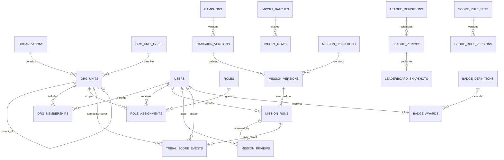

# Tribal Gamification — Architecture and Two-Agent Plan

- Status: **DESIGN / FOUNDATION IN PROGRESS — generic organization schema foundation is additive; no Tribal domain API/data workflows implemented**. The default-off bootstrap sentinel serves no bootstrap data; tenant-scoped read-only unit list/detail endpoints are available when explicitly enabled.
- Mode: P · Updated: 2026-11-12.
- Current backend base: `3d6b53b` (includes the Sales Quest BFF and dev/test login routes).
- Current frontend inspected: `mrkavousi/sales-quest-arena` `main` at `5c556fe`.
- This plan records the product clarifications received in this conversation; it does not promote existing PROPOSED decisions to APPROVED. The referenced visual image was not available among the files/attachments visible during this review, so visual direction remains text-only pending that reference.
- Related: [`tribal-api-contract.md`](../engineering/tribal-api-contract.md), [`game-bff-alignment.md`](../engineering/game-bff-alignment.md), [`database-erd.md`](database-erd.md).

## 1. Product direction recorded

| Concern | Current design input |
|---|---|
| Tribal language | `سرزمین / ایل / قبیله / تیره` is a UX metaphor. It is not a fixed database taxonomy or business hierarchy. |
| Organization data | Admin/back-office is the source of truth; first population is through validated Excel imports. No counts, names or membership lists are constants in application code. |
| Names and flags | Center-administered initially; later allow scoped users to manage them through RBAC. |
| Activity review | A report is routed to an authorized responsible reviewer. Reviewer is an administrator or supervisor with an RBAC grant in the relevant scope. A score is not final on local/client submission. |
| League authoring | An administrator can configure a league through a simple guided wizard. Metric weights and promotion/relegation rules remain configurable; no values are assumed here. |
| Visibility | Default for authenticated users is organization-wide visibility of player name, avatar, points and rank. Admin can change visibility policy. Other personal/report fields are not implied to be public. |
| Score domain | Tribal scores use a separate ledger. Do not write to the legacy `score_events`/wallet or the Sales Quest personal `game_progress` projection. |
| Offline completion | Client keeps a durable outbox item and marks it `pending_sync`; server receipt time is authoritative. After sync the report is `pending_review`; award/rank is final only after approval. |
| Business timezone | `Asia/Tehran` determines calendar-day and campaign-period boundaries. Persist instants in UTC; calculate and display period boundaries in Tehran. |

These are design constraints from the user, not approval to deploy or to make the legacy prototype production-safe.

## 2. Current architecture and impact

### Backend (current prototype)

- FastAPI modular monolith, explicit SQLite SQL, schema migrations `0001`–`0005`; `0005` adds only generic configurable org-unit types, same-tenant parent tree and effective-dated memberships. The Tribal bootstrap is gated OFF by default and returns no domain data.
- `users` belongs to one `organization_id`; its current roles are `visitor`, `operator`, `admin`.
- Existing `missions` are organization-scoped, mostly photo submissions with operator review; `competitions` are simple date windows.
- Existing `score_events` and wallet are individual organizational points. The Sales Quest BFF separately persists personal game progress and completions.
- `audit_logs` and `outbox_events` exist. Migration 0005 introduces the generic org-unit tree and memberships only; scoped supervisor grants, campaign targets, league definitions, metric-weighted score model, and badge model remain absent.
- Existing session/auth and migration runner are prototype-level. Migration runner has no automatic down migration/checksum; use additive schema, backup/restore and a tested recovery runbook rather than promising an automatic rollback.

### Frontend (current public main)

- React/Vite static PWA with English/Persian content, hash router, responsive visual system and install/update flows.
- Current mission/game state and answers are stored locally. No Tribal pages or backend sync outbox exists.
- Service worker precaches built static assets and does not intercept POST requests or cache unknown API requests. Offline API submission still needs an application-level durable outbox/retry state machine.
- Tribal must be an additive, feature-flagged module. Keep all existing game routes, local save key and offline play intact during rollout.

## 3. Target architecture

Keep a **modular monolith** until data/load evidence justifies another deployment boundary. Add a Tribal domain boundary in the backend (`app/tribal/` or equivalent) and a separate frontend module namespace. Existing visitor/operator/admin pages, tables and game progression remain backward-compatible.

### 3.1 Configurable organization tree

Use general organization units and centrally configured labels rather than fixed `territory → region → branch → team` tables or Tribal-named SQL entities:

- `org_unit_types`: configurable unit type code, translated/display labels, allowed parent types, display order and active status.
- `org_units`: tenant/org ID, type ID, parent unit ID, stable external key, name, status, effective dates, optional central-managed flag/icon metadata.
- `org_memberships`: user ID, unit ID, validity interval and source import; allow multiple/changed memberships without rewriting past periods.
- Keep the mapping from actual units to visible Tribal terms in presentation/configuration. The metaphor must not encode fixed hierarchy assumptions in business logic.

Start with parent adjacency and indexes; use recursive queries for ancestors/descendants. Add a closure/materialized path only if measured hierarchy-query performance requires it. Counts 6 regions/34 branches/1070 visitors are import/load-test inputs, not maximums or constants.

### 3.2 RBAC and data visibility

Separate authentication identity, organizational membership, role and permissions:

- Roles/permissions are data/configuration; user-role assignments have a scope unit and validity interval.
- Default reviewer capability is limited to an admin or supervisor explicitly assigned to the report’s unit/descendants.
- Default read policy exposes only name/avatar/points/rank to authenticated users; an admin-managed visibility policy controls the permitted fields and scope.
- Backend must enforce every read and write scope. Hiding a component in React is not authorization.
- Proposed safety invariant: a submitter cannot approve their own report. Confirm this before implementation; it was not specified as a product rule yet.

### 3.3 Admin Excel ingestion and reference data

The admin/back-office remains authoritative; Excel is the initial bulk-ingestion mechanism, not a hardcoded seed. Use staged imports:

1. Upload and fingerprint file; parse the declared template version.
2. Validate required columns, external IDs, hierarchy parentage, duplicates and row-level data.
3. Show preview/counts/errors; no writes to canonical entities yet.
4. Admin confirms import; apply rows in one transaction/batch with an import ID and audit.
5. Preserve rejected rows and source details for correction/re-import; never infer a user match from phone/name alone.

Define separate versioned templates for org units/memberships, users/identity mapping, product/customer/price-list references, targets and sales facts. Do not make all data a single opaque CSV blob. The exact owner/source and columns are still a prerequisite for API/ERD freeze.

### 3.4 Campaigns, missions and review

Keep campaign, mission definition, mission version, assignment, run/submission and review as distinct concepts:

- A campaign has status, date window in `Asia/Tehran`, owner/scope, versioned scoring configuration and target audience.
- A mission version defines scope (individual/team/unit), form schema, required reference-data selectors, validation rules, review requirement and immutable version.
- A run stores the specific mission version and validated answer IDs. A server-stamped `received_at` is authoritative; a client timestamp is untrusted metadata only.
- On initial sync a queued report transitions `pending_sync` (client only) → `pending_review` (server). Authorized admin/supervisor can approve/reject; review actor/time/reason are audited.
- Approval creates the Tribal award in the same transaction as status + audit. Idempotency protects retries. Rejected reports create no award.
- Exact validation source (selected product/customer vs reconciliation against imported/verified sales data) is mission-configurable, but each mission’s required validation must be specified before it is published.

### 3.5 Scoring, ranking and league

Create a separate append-only `tribal_score_events` ledger with event provenance, rule version, period, actor/subject dimension and scope unit. Keep individual, team, branch and region totals separate; never sum the same contribution into multiple ranks without an explicit aggregation rule.

The admin wizard selects from an allow-listed backend metric catalog, not arbitrary executable formulas. Candidate metrics from the brief:

- target attainment;
- average sales per active visitor;
- growth versus previous period;
- campaign-target achievement;
- verified activity quality;
- team collaboration.

Each score-rule version records input source, period, normalization/denominator behavior, weight, rounding and effective dates. Rules with unavailable inputs or invalid weights cannot be published. Weights, zero-denominator handling, missing data, tie-break and historical recalculation policy remain unset until approved.

League definitions/configurations and periods are separate from computed leaderboard snapshots. The wizard should ask only for subject scope, included units/users, period, metric preset/weights and visibility; expose promotion/relegation only if the admin chooses that option. Number of leagues and movement thresholds are not defaults in this design.

### 3.6 Badges, flags, audit and feature flag

- `badge_definitions` and immutable `badge_awards` have stable IDs, versioned conditions, provenance and idempotency.
- Clan/branch flags are centrally managed assets/references initially. Do not store arbitrary user-controlled file paths in a unit row.
- Reuse the audit/outbox concepts, adding actor, scope, before/after or diff, correlation/import ID and event time for every privileged change.
- Feature flag `tribal_gamification` defaults OFF; server denies module APIs while OFF, not merely hide frontend navigation. Enablement and edits are audited.

## 4. Conceptual ERD (proposal)

This is conceptual, not a migration specification. Exact nullable keys, uniqueness, history retention and data ownership are to be decided in the reviewed ERD.

## 5. Frontend information architecture

Add a `#/tribal` entry only when the server flag and user capability allow it. Reuse existing tokens, responsive shell and RTL/i18n patterns; use navy/gold/turquoise and restrained Iranian motifs, avoiding militaristic copy.

| Screen (proposal) | Main content |
|---|---|
| Tribal overview | Current unit, approved points/rank, active league/campaign, pending sync/review notices |
| Organization map/tree | Searchable units from API; presentation labels configurable; no count-based hardcoding |
| Unit/clan profile | Name/flag/area/manager/member count, rank/score, active campaigns, awards; fields filtered by server visibility policy |
| Role dashboard | Capabilities returned by API; central admin/back-office, admin, supervisor/reviewer and visitor views |
| League/rankings | League wizard for admin; paginated rankings and metric breakdown for permitted viewers |
| Missions/reports | Structured selectors, local durable offline outbox, queued/sync/review states, rejection feedback |
| Achievements | Earned and eligible badges with source/criteria explanation |

Do not replicate the scoring engine or authorization in React. UI permissions are hints; API response filtering is authoritative.

## 6. Two-agent implementation plan

| Stage | Backend Development Agent owns | Frontend Development Agent owns | Shared gate / deliverable |
|---|---|---|---|
| A. Design freeze | Review existing schema/auth; refine ERD, import contracts, OpenAPI/error/role matrix | Review PWA routes, screens and offline states; propose wireframes/component map | Orchestrator presents one versioned API + screen contract for owner review; no simultaneous edits |
| B. Foundation, flag OFF | Additive hierarchy/membership/RBAC/import batch model and scoped read APIs | Feature-flagged Tribal shell, org map and profiles driven only by API | Synthetic import and role/scope negative tests; legacy app/storage unchanged |
| C. Mission workflow | Versioned campaigns/missions/runs/reviews, Tehran dates, validation and idempotent approval transaction | Mission/report UI, drafts, offline outbox, reviewer queue views | Pending-sync → pending-review → approved/rejected contract tests |
| D. Score and league | Separate ledger, metric registry/config versions, computations, snapshots, league wizard API | League wizard, ranking and explainable metric views | Golden calculation fixtures and field-level visibility tests |
| E. Badges and polish | Badge definitions/awards, audit and asset permissions | Clan badges/flags, dashboards, localization, responsive states | E2E; accessibility and safe PWA update/offline behavior |
| F. Rollout | Load/security/migration recovery, flag enforcement, operational docs | Progressive enablement, migration notice, reconnect/conflict UX | Independent PRs; integration/orchestrator verifies contract, no legacy regression; enable only after approval |

**File ownership:** Backend owns `app/**`, `db/migrations/**`, backend tests and the OpenAPI contract once frozen. Frontend owns the external repository’s `src/**`, styles, API client and frontend tests. The architecture/ERD and integration test harness are Orchestrator-owned. Frontend consumes generated types from the frozen contract; it does not edit backend schema or implement business scoring.

## 7. Safety, scale and DoD

- Start disabled; existing app, six game missions, `game_progress`, localStorage key and offline play remain intact.
- Imports are previewed and confirmed; never delete/overwrite canonical data implicitly. Keep import provenance and audit.
- Migrations are additive. Since current runner has no down migrations, document backup/restore and test recovery on a copy; do not claim automatic rollback.
- Test authorization on every route: same unit, descendants, sibling unit, other organization, inactive membership, unauthorized reviewer and admin-only edits.
- Verify no award before approval, exactly-once award after retries, no award on rejection, no cross-ledger writes, correct Tehran boundary, import replay and outbox replay.
- Test generated synthetic data at minimum 1070 users/34 branches/6 regions, paginated API, aggregate query plans and concurrent submission/load. This is a test volume, not a capacity promise; SQLite write limits may require an approved production DB decision.
- Existing tests and current game E2E/PWA tests remain green. Frontend integration must cover offline report queue, retry, duplicate prevention, stale content/version and browser storage failure.
- DoD includes approved API/ERD, RBAC matrix, import templates, scoring policy/version, test evidence, security review, runbook and disabled-by-default rollout plan.

## 8. Still requires owner/product input before implementation

1. Exact Excel template columns, authoritative source and stable external keys for users/units/products/customers/price lists/targets.
2. Per-mission verification source and which reports require human review; only the reviewer roles/scope have been specified so far.
3. Metric definitions, available target/history data, weight constraints, normalization, missing/zero denominator behavior, rounding and correction policy.
4. League periods, tie-breaks, number of tiers, promotion/relegation behavior and when configuration changes take effect.
5. Whether self-approval is forbidden (recommended) and whether supervisors can review own direct reports.
6. Visibility policy schema: the currently requested default fields are confirmed, but exactly which admin scopes can change policy is not yet specified.
7. Retention/privacy for answers, customer selectors, import rows, badge history and audit details.
8. Production authentication, DB/hosting, session transport and availability expectations remain governed by existing OPEN decisions.

The earlier user message ended in an empty “10.”; no tenth requirement has been inferred from it.
